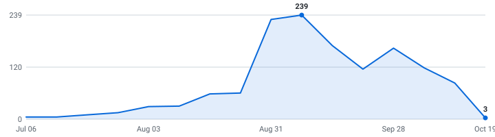

# 🎓 Summer 2027 Mechanical & Aerospace Internships

**A self-updating engine that tracks mechanical & aerospace internships so you don't have to.**

&nbsp;&nbsp;&nbsp;

### 777 open roles (434 listed below) · 111 new this week

4,768 employers tracked · updated Oct 28, 2026 at 13:17 UTC

_509 have a cycle the employer stated · 268 are recent postings whose cycle isn't stated (listed separately, never mixed in)._

**[🖥️ Live dashboard](https://pranavd1437.github.io/mechanical-aerospace-internship-engine/)** · **[📡 RSS](https://pranavd1437.github.io/mechanical-aerospace-internship-engine/feed.xml)** · **[⚙️ JSON API](https://pranavd1437.github.io/mechanical-aerospace-internship-engine/api/jobs.json)**

> [!TIP]
> **⭐ Star this repo** to save it and get updates when new roles are added.

Instead of refreshing a dozen career pages by hand, it reads company hiring feeds directly and keeps one live list — newest roles on top, refreshed automatically every six hours.

**🔔 Alerts without sharing an email:** follow the [RSS feed](https://pranavd1437.github.io/mechanical-aerospace-internship-engine/feed.xml) in any reader. Saved roles stay in your browser.

---

## What this is

This is an engine, not a hand-kept list. It polls company career feeds every six hours, finds the internships, removes duplicates, and rebuilds this page on its own.

Every link comes straight from the source — so it's real and current, not a stale list someone forgot to update. Speed matters.

## What makes this different

| | |
|---|---|
| 📅 **[Drop Radar](#drop-radar)** | A forecast of **what's coming**. Each marquee company's typical opening window, replaced by the real drop date the moment the engine catches it live. Windows are estimates and labelled as such; only dates the engine saw itself are marked verified. |
| 🛂 **Visa intel, computed** | 🇺🇸 / 🛂 flags detected automatically from every job description, plus ✓ for employers with a real H-1B track record (USCIS data, FY2022-23 — a history, not a promise). The big lists crowdsource this by hand; here it's code. Most postings say nothing either way, and those show as unknown rather than guessed. |
| 📆 **A real date on nearly every role** | Taken from the job portal itself wherever the portal states one, so newest-first actually means newest. The exact coverage figure is printed at the bottom of this page every run. |
| 🧰 **Skill tags + pay, extracted** | Every posting's text is scanned for the tools it wants (SolidWorks, GD&T, ANSYS, …) and the pay it states — searchable on the [dashboard](https://pranavd1437.github.io/mechanical-aerospace-internship-engine/), and included in the CSV and API. |
| 🔔 **Alerts your way** | Follow the [RSS feed](https://pranavd1437.github.io/mechanical-aerospace-internship-engine/feed.xml), or connect it to an RSS-capable alert tool. The dashboard's saved roles stay in your browser. |
| ⚙️ **An engine, not a spreadsheet** | 4,908 job-board endpoints (4,768 distinct employers; some run more than one board) polled every six hours across 12 ATS platforms. Full source and tests in this repo. |

## Scope

| | |
|---|---|
| **Roles** | Mechanical design/CAD, structures/FEA, manufacturing/test, thermal/fluids/propulsion, materials, controls/mechatronics, and systems engineering internships |
| **Region** | United States |
| **Cycles** | Summer 2027 and Fall 2026 |

## About

This fork adapts the open-source Internship Engine for a focused mechanical and aerospace search while preserving source-first links and human review before any application.

Use it to spot roles early and apply before they fill up. Being first genuinely helps.

## Where this is going

I'm building this in the open and adding to it as it grows.

**Included:** RSS alerts · the Drop Radar · auto-detected sponsorship flags · the live dashboard

**Mechanical scope:** design/CAD · structures/FEA · manufacturing/test · thermal/fluids/propulsion · materials · controls/mechatronics · systems

If it helps you, a star means a lot and tells me to keep going.

## How to use

<b>Reading the table — flags, dates, and the cycle split</b> (click to expand)

- Roles are grouped by cycle below - **newest posting on top, oldest at the bottom.**
- A cycle section holds only roles whose **employer stated that cycle** - in the title, or in the posting's own text. Postings that name no cycle anywhere are in *Recently posted — cycle not stated* further down, with **no cycle guessed for them**. Same quality bar, different amount of evidence.
- The **Posted** column is the date the company published the role.
- **🆁 after a company name** = **this role is remote** — the posting's own location or title says so. It marks the role on that row, not the whole company.
- **Flags after a role title:** 🇺🇸 = requires U.S. citizenship or a security clearance · 🛂 = the posting says it won't sponsor a work visa · 🆕 = spotted in the last 48 hours. Sponsorship flags are detected automatically from each job description - treat them as a strong hint and confirm on the posting.
- **✓ after a company name** = a real H-1B track record: USCIS approved 10+ petitions for that employer in FY2022–2023 (matched automatically against the official [H-1B Employer Data Hub](https://www.uscis.gov/tools/reports-and-studies/h-1b-employer-data-hub)). No ✓ doesn't mean they won't sponsor - it means we can't prove they have.
- Track your applications with [`data/internships.csv`](data/internships.csv) (opens in Excel / Google Sheets).
- Missing a company? Adding one takes a single line, see [CONTRIBUTING.md](CONTRIBUTING.md).

---

## Summer 2027  (251 employer-stated)

| Company | Role | Category | Location | Skills | Posted | Apply |
|---|---|---|---|---|---|---|
| Carpenter Technology | Metallurgy Intern 🇺🇸 🆕 | Materials Engineering | Tanner, AL | No skills listed | Oct 28, 2026 | [Apply](https://cartech.wd5.myworkdayjobs.com/CTCExternal/job/Tanner-AL/Metallurgy-Intern_26967) |
| RTX | Manufacturing Execution System (MES) Co-Op (Spring/Summer 2027) 🇺🇸 🆕 | Manufacturing & Quality | US-IA-CEDAR RAPIDS-105 ~ 400 Collins Rd… | PLM | Oct 28, 2026 | [Apply](https://globalhr.wd5.myworkdayjobs.com/rec_rtx_ext_gateway/job/US-IA-CEDAR-RAPIDS-105--400-Collins-Rd-NE--BLDG-105/Manufacturing-Execution-System--MES--Co-Op--Spring-Summer-2027-_01885556) |
| Northrop Grumman | 2027 Aerospace Engineering Internship - Linthicum MD 🇺🇸 🆕 | Aerospace & Flight Sciences | United States-Maryland-Linthicum | No skills listed | Oct 27, 2026 | [Apply](https://ngc.wd1.myworkdayjobs.com/Northrop_Grumman_External_Site/job/United-States-Maryland-Linthicum/XMLNAME-2027-Aerospace-Engineering-Internship---Linthicum-MD_R10256786) |
| Scout AI | Mechanical Engineer Intern (Summer 2027) 🆕 | Mechanical Design | Sunnyvale, CA | SolidWorks, CAD, FEA | Oct 27, 2026 | [Apply](https://jobs.ashbyhq.com/scout-ai/fba467c4-30e8-4ee1-8ac9-20b48e132076) |
| Olsson | Mechanical Engineering Internship - Data Center Facilities 🆕 | Mechanical Design | Omaha, NE | No skills listed | Oct 27, 2026 | [Apply](https://job-boards.greenhouse.io/olsson/jobs/5465495008) |
| Olsson | Mechanical Engineering Internship - Data Center Facilities 🆕 | Mechanical Design | North Kansas City, MO | No skills listed | Oct 27, 2026 | [Apply](https://job-boards.greenhouse.io/olsson/jobs/5465496008) |
| WSP | Mechanical Engineering Intern - Summer 2027 🆕 | Mechanical Design | Tempe, AZ, United States | AutoCAD | Oct 27, 2026 | [Apply](https://emit.fa.ca3.oraclecloud.com/hcmUI/CandidateExperience/en/sites/CX_2001/job/98372) |
| Clean Harbors ✓ | Mechanical Engineer Intern - Summer 2027 🆕 | Mechanical Design | El Dorado, AR, United States | CAD | Oct 27, 2026 | [Apply](https://epyc.fa.us2.oraclecloud.com/hcmUI/CandidateExperience/en/sites/CX_1001/job/167555) |
| Nissan ✓ | Industrial Engineering Intern - Summer 2027 - Canton, MS 🆕 | Manufacturing & Quality | Canton +1 more | Six Sigma, Lean Manufacturing | Oct 27, 2026 | [Apply](https://alliance.wd3.myworkdayjobs.com/nissanjobs/job/Canton-Mississippi---United-States-of-America/Industrial-Engineering-Intern---Summer-2027---Canton--MS_R00214256) |
| Nissan ✓ | Machining Reliability Intern - Summer 2027 - Decherd, TN 🆕 | Manufacturing & Quality | Decherd +1 more | No skills listed | Oct 27, 2026 | [Apply](https://alliance.wd3.myworkdayjobs.com/nissanjobs/job/Decherd-Tennessee---United-States-of-America/Machining-Reliability-Intern---Summer-2027---Decherd--TN_R00214293) |
| Global Infrastructure | Intern, Mechanical Designer 🆕 | Mechanical Design | US / CA / Los Angeles - 707 Wilshire Bo… | AutoCAD, CAD | Oct 27, 2026 | [Apply](https://gi.wd1.myworkdayjobs.com/Global_Infrastructure/job/US--CA--Los-Angeles---707-Wilshire-Boulevard/Intern--Mechanical-Designer_6633) |
| RTX | Quality Engineering Intern (Summer 2027) 🇺🇸 🆕 | Manufacturing & Quality | US-CO-COLORADO SPRINGS-793 ~ 1225 Aerop… | GD&T, FMEA | Oct 27, 2026 | [Apply](https://globalhr.wd5.myworkdayjobs.com/rec_rtx_ext_gateway/job/US-CO-COLORADO-SPRINGS-793--1225-Aeroplaza-Dr--AEROPLAZA/Quality-Engineering-Intern--Summer-2027-_01882062) |
| RTX | Product Quality Engineering Co-Op (Spring/Summer 2027) 🇺🇸 🆕 | Manufacturing & Quality | US-IA-CEDAR RAPIDS-108 ~ 400 Collins Rd… | No skills listed | Oct 27, 2026 | [Apply](https://globalhr.wd5.myworkdayjobs.com/rec_rtx_ext_gateway/job/US-IA-CEDAR-RAPIDS-108--400-Collins-Rd-NE--BLDG-108/Product-Quality-Engineering-Co-Op--Spring-Summer-2027-_01885440) |
| Ingredion | Reliability Engineering Co-op (May-Dec) - Indianapolis, IN 🆕 | Test & Validation | Indianapolis, IN | No skills listed | Oct 27, 2026 | [Apply](https://ingredion.wd1.myworkdayjobs.com/IngredionCareers/job/Indianapolis-IN/Reliability-Engineering-Co-op----Indianapolis--IN_Req-40019-1) |
| Moog | Intern, Additive Manufacturing Engineering 🆕 | Manufacturing & Quality | Buffalo, NY | No skills listed | Oct 27, 2026 | [Apply](https://moog.wd5.myworkdayjobs.com/moog_external_career_site/job/Buffalo-NY/Intern--Additive-Manufacturing-Engineering_R-26-20786) |
| Philips | Co-op -Embedded Test Engineer - Murrysville, PA-January-June 2027 🆕 | Test & Validation | Murrysville, Pennsylvania, United States | C# | Oct 27, 2026 | [Apply](https://philips.wd3.myworkdayjobs.com/jobs-and-careers/job/Murrysville-Pennsylvania-United-States/Co-op--Embedded-Test-Engineer---Murrysville--PA-January-June-2027_592065) |
| Radiance Technologies | Mechanical Engineer Intern 🇺🇸 🆕 | Mechanical Design | Huntsville, AL | MATLAB, SolidWorks | Oct 27, 2026 | [Apply](https://radiancetech.wd12.myworkdayjobs.com/Radiance_External/job/Huntsville-AL/Mechanical-Engineer-Intern_HR102534) |
| GIPathfinder | Manufacturing Engineering Co-op Jan - June 2027 🆕 | Manufacturing & Quality | Burlingame, California, United States | SolidWorks, CAD, DFM/DFA | Oct 26, 2026 | [Apply](https://job-boards.greenhouse.io/gipathfinder/jobs/4747868005) |
| HP IQ | Product Design Engineering Intern (Summer 2027) 🆕 | Mechanical Design | San Francisco, CA | CAD, CNC, DFM/DFA, Tolerance Analysis | Oct 26, 2026 | [Apply](https://job-boards.greenhouse.io/hpiq/jobs/6141235004) |
| Sierra Nevada Corporation | Mechanical Engineer Intern - Summer 2027 (For SNC Summer 2026 Interns Only) 🇺🇸 🆕 | Mechanical Design | Lone Tree, CO | MATLAB, CAD | Oct 26, 2026 | [Apply](https://snc.wd1.myworkdayjobs.com/snc_external_career_site/job/Lone-Tree-CO/Mechanical-Engineer-Intern---Summer-2027--For-SNC-Summer-2026-Interns-Only-_R0031083) |
| Skydio ✓ | Manufacturing Intern - Summer 2027 🆕 | Manufacturing & Quality | Hayward, California, United States | SQL, SolidWorks, DFM/DFA, Databricks | Oct 26, 2026 | [Apply](https://jobs.ashbyhq.com/skydio/8f4f62b0-a2ea-498d-b78f-6f661b724a3c) |
| Parallel Systems | Hardware Engineering Intern (Mechanical & Electrical) 🆕 | Mechanical Design | Los Angeles, CA | CAD | Oct 26, 2026 | [Apply](https://boards.greenhouse.io/parallel/jobs/5275660007?gh_jid=5275660007) |
| S&C Electric Company ✓ | Mechanical Engineer (Facilities) Intern 🆕 | Mechanical Design | Chicago, IL, United States | AutoCAD, CAD | Oct 26, 2026 | [Apply](https://ejia.fa.us6.oraclecloud.com/hcmUI/CandidateExperience/en/sites/CX_1001/job/107465) |
| Global Infrastructure | Intern, Mechanical Designer 🆕 | Mechanical Design | CA / AB / Calgary - 685 Centre Street S… | AutoCAD, CAD | Oct 26, 2026 | [Apply](https://gi.wd1.myworkdayjobs.com/Global_Infrastructure/job/CA--AB--Calgary---685-Centre-Street-Southwest/Intern--Mechanical-Designer_6605) |
| Global Infrastructure | Intern, Mechanical Designer 🆕 | Mechanical Design | CA / BC / Vancouver - 200 Granville Str… | AutoCAD, CAD | Oct 26, 2026 | [Apply](https://gi.wd1.myworkdayjobs.com/Global_Infrastructure/job/CA--BC--Vancouver---200-Granville-Street/Intern--Mechanical-Designer_6607) |
| JM Family | Advance Manufacturing Engineering Intern 🆕 | Manufacturing & Quality | Florida - Jacksonville | AutoCAD | Oct 26, 2026 | [Apply](https://jmfamily.wd1.myworkdayjobs.com/jmfamily_external/job/Florida---Jacksonville/Advance-Manufacturing-Engineering-Intern_JR105079) |
| Northrop Grumman | 2027 Mechanical Engineering Intern - Clearfield UT 🇺🇸 🆕 | Mechanical Design | United States-Utah-Clearfield | No skills listed | Oct 26, 2026 | [Apply](https://ngc.wd1.myworkdayjobs.com/Northrop_Grumman_External_Site/job/United-States-Utah-Clearfield/XMLNAME-2027-Mechanical-Engineering-Intern---Clearfield-UT_R10257639-1) |
| Sherwin-Williams ✓ | June 2027 Packaging Engineering Co-Op - Brecksville, OH 🆕 | Mechanical Design | Brecksville, OH, United States | No skills listed | Oct 26, 2026 | [Apply](https://ejhp.fa.us6.oraclecloud.com/hcmUI/CandidateExperience/en/sites/CX_2/job/2627473) |
| Shield AI | June 2027 Co-op - Reliability Engineering #5953 | Test & Validation | Seattle, Washington | Python, FMEA | Oct 23, 2026 | [Apply](https://jobs.lever.co/shieldai/bef440ce-0365-4de7-9b1e-b1288cdaf7f3) |
| TREK ✓ | Mechanical Engineering Intern | Mechanical Design | Waterloo, Wisconsin | CAD | Oct 23, 2026 | [Apply](https://trekbikes.wd1.myworkdayjobs.com/TREK/job/Waterloo-Wisconsin/Mechanical-Engineering-Intern_Trek115843) |
| Gevernova | GE Vernova Manufacturing Process Engineer Intern - Summer 2027 🛂 | Manufacturing & Quality | Charleroi USA | SolidWorks, AutoCAD, CAD, Six Sigma | Oct 23, 2026 | [Apply](https://gevernova.wd5.myworkdayjobs.com/only_confidential_executive_recruiting/job/Charleroi-USA/GE-Vernova-Manufacturing-Process-Engineer-Intern---Summer-2027_R5053285) |
| GlobalFoundries ✓ | Industrial Engineering Intern (Summer 2027) | Manufacturing & Quality | USA - Vermont - Essex Junction | No skills listed | Oct 23, 2026 | [Apply](https://globalfoundries.wd1.myworkdayjobs.com/External/job/USA---Vermont---Essex-Junction/Industrial-Engineering-Intern--Summer-2027-_JR-2604630) |
| STV ✓ | Mechanical Engineering Intern - Summer 2027 🛂 | Mechanical Design | Philadelphia, Pennsylvania | No skills listed | Oct 23, 2026 | [Apply](https://stvinc.wd5.myworkdayjobs.com/stv/job/Philadelphia-Pennsylvania/Mechanical-Engineering-Intern---Summer-2027_JR6097-1) |
| Verdantas | Mechanical Engineer Summer Intern | Mechanical Design | Holden MA | SolidWorks, AutoCAD | Oct 23, 2026 | [Apply](https://verdantas.wd108.myworkdayjobs.com/Verdantas/job/Holden-MA/Mechanical-Engineer-Summer-Intern_R-101230) |
| OATEY | Design Engineering Intern | Mechanical Design | Shakopee, MN (Manufacturing) | SolidWorks, AutoCAD, CAD, GD&T | Oct 22, 2026 | [Apply](https://wd5.myworkdaysite.com/recruiting/oatey/Oatey_External_/job/Shakopee-MN-Manufacturing/Design-Engineering-Intern_R7272) |
| Motorola ✓ | Mechanical Engineering Intern - Summer 2027 | Mechanical Design | Schaumburg, IL | CAD | Oct 22, 2026 | [Apply](https://motorolasolutions.wd5.myworkdayjobs.com/Careers/job/Schaumburg-IL/Mechanical-Engineering-Intern---Summer-2027_R69727) |
| Commonwealth Fusion Systems | Intern - Materials Test Engineer - Summer 2027 | Test & Validation | Devens, MA | No skills listed | Oct 22, 2026 | [Apply](https://jobs.lever.co/cfsenergy/da8cc185-70d0-4a8e-b484-9866c71b593e) |
| Charter Manufacturing | Quality Engineer Intern (Summer 2027) | Manufacturing & Quality | Charter Aarrowcast - Shawano, WI | FMEA, Six Sigma | Oct 22, 2026 | [Apply](https://chartermfg.wd5.myworkdayjobs.com/Charter_Careers/job/Charter-Aarrowcast---Shawano-WI/Quality-Engineer-Intern--Summer-2027-_R08205) |
| Insulet Corporation ✓ | Co-op - Supplier Quality Engineering: January - June 2027 (Onsite) | Manufacturing & Quality | Acton, Massachusetts | Six Sigma | Oct 22, 2026 | [Apply](https://insulet.wd5.myworkdayjobs.com/insuletcareers/job/Acton-Massachusetts/Co-op---Supplier-Quality-Engineering--January---June-2027--Onsite-_REQ-2026-18127) |
| Insulet Corporation ✓ | Co-op, Mechanical Engineer: January-June 2027 (Onsite) | Mechanical Design | Acton, Massachusetts | SolidWorks, CAD | Oct 22, 2026 | [Apply](https://insulet.wd5.myworkdayjobs.com/insuletcareers/job/Acton-Massachusetts/Co-op--Mechanical-Engineer--January-June-2027--Onsite-_REQ-2026-18798) |
| Insulet Corporation ✓ | Co-op - Supplier Quality Engineering: January - June 2027 (Onsite) | Manufacturing & Quality | US - Massachusetts (Acton - Office) | Six Sigma | Oct 22, 2026 | [Apply](https://insulet.wd5.myworkdayjobs.com/insuletcareers/job/US---Massachusetts-Acton---Office/Co-op---Supplier-Quality-Engineering--January---June-2027--Onsite-_REQ-2026-18126) |
| Lowe's | Industrial Engineer Intern – Undergrad Internship – Summer 2027 - Field | Manufacturing & Quality | Mooresville, NC (SSC) 1999 | Six Sigma | Oct 22, 2026 | [Apply](https://lowes.wd5.myworkdayjobs.com/LWS_External_CS/job/Mooresville-NC-SSC-1999/Industrial-Engineer-Intern---Undergrad-Internship---Summer-2027---Field_JR-02681866) |
| Sierra Nevada Corporation | Mechanical Engineer Intern (Summer 2027) 🇺🇸 | Mechanical Design | Lone Tree, CO | MATLAB, CAD | Oct 22, 2026 | [Apply](https://snc.wd1.myworkdayjobs.com/snc_external_career_site/job/Lone-Tree-CO/Mechanical-Engineer-Intern--Summer-2027-_R0031177) |
| Sierra Nevada Corporation | Structural Engineering Intern - Summer 2027 🇺🇸 | Structures & FEA | Lone Tree, CO | MATLAB, CAD | Oct 22, 2026 | [Apply](https://snc.wd1.myworkdayjobs.com/snc_external_career_site/job/Lone-Tree-CO/Structural-Engineering-Intern---Summer-2027_R0031160-1) |
| Stryker ✓ | Summer 2027 Internship - Mechanical Engineer | Mechanical Design | Massachusetts, Virtual Address | CAD, FEA | Oct 22, 2026 | [Apply](https://stryker.wd1.myworkdayjobs.com/StrykerCareers/job/Massachusetts-Virtual-Address/Summer-2027-Internship---Mechanical-Engineer_R573345) |
| DoorDash ✓ | Mechanical Engineering, Intern - Labs (Summer 2027) | Mechanical Design | Oakland, CA | SolidWorks, Siemens NX, CATIA, CAD | Oct 22, 2026 | [Apply](https://job-boards.greenhouse.io/doordashusa/jobs/8313401) |
| RESPEC | Student Engineering Intern (Structural) | Structures & FEA | Anchorage, AK, United States | AutoCAD | Oct 22, 2026 | [Apply](https://jobs.smartrecruiters.com/RESPECInc/744000157189739) |
| GlobalFoundries ✓ | Industrial Engineering Intern (Summer 2027) | Manufacturing & Quality | USA - Vermont - Essex Junction | Python, SQL | Oct 21, 2026 | [Apply](https://globalfoundries.wd1.myworkdayjobs.com/External/job/USA---Vermont---Essex-Junction/Industrial-Engineering-Intern--Summer-2027-_JR-2604569) |
| Northrop Grumman | 2027 Stress Analysis and Tooling Design Engineer Intern - Commerce CA 🇺🇸 | Structures & FEA | United States-California-Commerce | MATLAB, SolidWorks, Siemens NX, CATIA | Oct 21, 2026 | [Apply](https://ngc.wd1.myworkdayjobs.com/Northrop_Grumman_External_Site/job/United-States-California-Commerce/XMLNAME-2027-Stress-Analysis-and-Tooling-Design-Engineer-Intern---Commerce-CA_R10257184) |
| Moog | Intern, Manufacturing and Industrial Engineering | Manufacturing & Quality | Torrance, CA | No skills listed | Oct 21, 2026 | [Apply](https://moog.wd5.myworkdayjobs.com/moog_external_career_site/job/Torrance-CA/Intern--Manufacturing-and-Industrial-Engineering_R-26-19823) |
| Moog | Intern, Quality Engineering | Manufacturing & Quality | Torrance, CA | No skills listed | Oct 21, 2026 | [Apply](https://moog.wd5.myworkdayjobs.com/moog_external_career_site/job/Torrance-CA/Intern--Quality-Engineering_R-26-19822) |
| Stanley Black & Decker ✓ | Packaging Engineering Intern - Summer 2027 | Mechanical Design | Towson, MD, United States | CAD | Oct 21, 2026 | [Apply](https://sbdinc.wd1.myworkdayjobs.com/Stanley_Black_Decker_Career_Site/job/Towson-MD-United-States/Packaging-Engineering-Intern---Summer-2027_REQ-1000052823) |
| Smith+Nephew ✓ | Intern Mechanical Engineering | Mechanical Design | Mansfield, MA | SolidWorks, CAD, FEA | Oct 21, 2026 | [Apply](https://smithnephew.wd5.myworkdayjobs.com/External/job/Mansfield-MA/Intern-Mechanical-Engineering_R92958) |
| Amazon ✓ | Industrial Design Engineer Intern , Summer 2027 | Mechanical Design | Bellevue, Washington, USA | SolidWorks, AutoCAD, CAD | Oct 20, 2026 | [Apply](https://www.amazon.jobs/en/jobs/10584122/industrial-design-engineer-intern-summer-2027) |
| Amcor | Tooling Design Engineering Intern (Summer 2027) | Manufacturing & Quality | RPSNA Erie (ERPA) PA | CAD, GD&T, CNC | Oct 20, 2026 | [Apply](https://amcor.wd5.myworkdayjobs.com/amcor_external_career_site/job/RPSNA-Erie-ERPA-PA/Tooling-Design-Engineering-Intern--Summer-2027-_REQ_97446) |
| CACI | Electrical Test Engineering Intern - Summer 2027 🇺🇸 | Test & Validation | Danbury, CT, US | Python | Oct 20, 2026 | [Apply](https://caci.wd1.myworkdayjobs.com/external/job/Danbury-CT-US/Electrical-Test-Engineering-Intern---Summer-2027_333809) |
| General Motors ✓ | 2027 Summer Intern - Manufacturing Excellence Industrial Engineering | Manufacturing & Quality | Warren +2 more | Python, SQL, Lean Manufacturing, Tableau | Oct 20, 2026 | [Apply](https://generalmotors.wd5.myworkdayjobs.com/Careers_GM/job/Warren-Michigan-United-States-of-America/XMLNAME-2027-Summer-Intern---Manufacturing-Excellence-Industrial-Engineering_JR-202622634) |
| IMEG ✓ | Mechanical Engineering Co-op / Philadelphia, PA | Mechanical Design | Philadelphia, PA | AutoCAD | Oct 20, 2026 | [Apply](https://wd1.myworkdaysite.com/recruiting/imeg/Imeg_Careers/job/Philadelphia-PA/Mechanical-Engineering-Co-op---Philadelphia--PA_R-16908) |
| Merck | 2027 Future Talent Program – Protein and Structural Chemistry – Co-op | Structures & FEA | USA - Massachusetts - Boston (MA Parcel… | No skills listed | Oct 20, 2026 | [Apply](https://msd.wd5.myworkdayjobs.com/searchjobs/job/USA---Massachusetts---Boston-MA-Parcel-B-Laboratory/XMLNAME-2027-Future-Talent-Program---Protein-and-Structural-Chemistry---Co-op_R422300) |
| Watts Water | Manufacturing Engineer Co-Op, Jan-June 2027 | Manufacturing & Quality | Germantown, WI | SolidWorks, AutoCAD | Oct 20, 2026 | [Apply](https://wattswater.wd5.myworkdayjobs.com/Intern-External/job/Germantown-WI/Manufacturing-Engineer-Co-Op--Jan-June-2027_10017699) |
| Zebra Technologies ✓ | 2027 Summer Internship (US) - Mechanical Engineer 🛂 | Mechanical Design | Holtsville, New York | Python, CAD, GD&T, LLMs | Oct 20, 2026 | [Apply](https://zebra.wd501.myworkdayjobs.com/Zebra_careers/job/Holtsville-New-York/XMLNAME-2027-Summer-Internship--US----Mechanical-Engineer_JR103627) |
| Anduril | 2027 Field Test Engineer Intern | Test & Validation | Costa Mesa +5 more | Computer Vision, Linux | Oct 19, 2026 | [Apply](https://boards.greenhouse.io/andurilindustries/jobs/5268689007?gh_jid=5268689007) |
| Anduril | 2027 Guidance, Navigation, & Control Engineer Intern | Controls & Mechatronics | Costa Mesa, California, United States | MATLAB, Simulink, Computer Vision | Oct 19, 2026 | [Apply](https://boards.greenhouse.io/andurilindustries/jobs/5268736007?gh_jid=5268736007) |
| Clean Harbors ✓ | Mechanical Project Engineer Intern - Summer 2027 | Mechanical Design | Dugway, UT, United States | CAD | Oct 19, 2026 | [Apply](https://epyc.fa.us2.oraclecloud.com/hcmUI/CandidateExperience/en/sites/CX_1001/job/167236) |
| Alcon ✓ | Spring/Summer 2027 Manufacturing Science & Technology Co-op | Manufacturing & Quality | Fort Worth, Texas | PLM | Oct 19, 2026 | [Apply](https://alcon.wd5.myworkdayjobs.com/careers_alcon/job/Fort-Worth-Texas/Spring-Summer-2027-Manufacturing-Science---Technology-Co-op_R-2026-50373) |
| Nissan ✓ | Industrial Engineering Intern - Summer 2027 - Smyrna, TN | Manufacturing & Quality | Smyrna +1 more | No skills listed | Oct 19, 2026 | [Apply](https://alliance.wd3.myworkdayjobs.com/nissanjobs/job/Smyrna-Tennessee---United-States-of-America/Industrial-Engineering-Intern---Summer-2027---Smyrna--TN_R00214284) |
| Badger Meter | Systems Integration - Engineering Intern | Systems Engineering | US - WI - Milwaukee HQ | Python | Oct 19, 2026 | [Apply](https://badgermeter.wd5.myworkdayjobs.com/US_CareerSite/job/US---WI---Milwaukee-HQ/Systems-Integration---Engineering-Intern_4641) |
| CACI | Production Engineering Intern - Summer 2027 🇺🇸 | Manufacturing & Quality | Danbury, CT, US | CAD | Oct 19, 2026 | [Apply](https://caci.wd1.myworkdayjobs.com/external/job/Danbury-CT-US/Production-Engineering-Intern---Summer-2027_333767) |
| CACI | Mechanical Engineering Intern - Summer 2027 🇺🇸 | Mechanical Design | Dulles, VA, US | SolidWorks, CAD, FEA, CFD | Oct 19, 2026 | [Apply](https://caci.wd1.myworkdayjobs.com/external/job/Dulles-VA-US/Mechanical-Engineering-Intern---Summer-2027_333564) |
| Charter Manufacturing | Materials Engineer Intern (Summer 2027) | Materials Engineering | Charter Aarrowcast - Shawano, WI | CAD | Oct 19, 2026 | [Apply](https://chartermfg.wd5.myworkdayjobs.com/Charter_Careers/job/Charter-Aarrowcast---Shawano-WI/Materials-Engineer-Intern--Summer-2027-_R08192) |
| Philips | Intern/Co-op - STET Mechanical Engineer – Latham, NY – Spring/Summer 2027 | Mechanical Design | Latham, New York, United States | CAD | Oct 19, 2026 | [Apply](https://philips.wd3.myworkdayjobs.com/jobs-and-careers/job/Latham-New-York-United-States/Intern-Co-op---STET-Mechanical-Engineer---Latham--NY---Spring-Summer-2027_591053) |
| Johnson & Johnson | Quality Engineering Co-Op, Summer 2027 | Manufacturing & Quality | Cincinnati +2 more | No skills listed | Oct 19, 2026 | [Apply](https://jj.wd5.myworkdayjobs.com/JJ/job/Cincinnati-Ohio-United-States-of-America/Quality-Engineering-Co-Op--Summer-2027_R-103624) |
| GlobalFoundries ✓ | Industrial Engineering Intern (Summer 2027) | Manufacturing & Quality | USA - New York - Malta | Six Sigma | Oct 16, 2026 | [Apply](https://globalfoundries.wd1.myworkdayjobs.com/External/job/USA---New-York---Malta/Industrial-Engineering-Intern--Summer-2027-_JR-2604575) |
| OATEY | Materials Intern - Cleveland Manufacturing | Manufacturing & Quality | Cleveland, OH (Manufacturing) | No skills listed | Oct 15, 2026 | [Apply](https://wd5.myworkdaysite.com/recruiting/oatey/Oatey_External_/job/Cleveland-OH-Manufacturing/Materials-Intern---Cleveland-Manufacturing_R7196) |
| Commonwealth Fusion Systems | Intern - Mechanical Engineer - Summer 2027 | Mechanical Design | Milpitas, CA | CAD, FEA | Oct 15, 2026 | [Apply](https://jobs.lever.co/cfsenergy/9690a768-362f-4df8-86a1-554b896cbc76) |
| Commonwealth Fusion Systems | Intern - Controls Engineer - Summer 2027 | Controls & Mechatronics | Milpitas, CA | AutoCAD | Oct 15, 2026 | [Apply](https://jobs.lever.co/cfsenergy/e3408817-347e-45bc-8627-305b75b6b978) |
| Inversion Space | Avionics Mechanical Engineer - Summer Internship 2027 🇺🇸 | Mechanical Design | Playa Vista, California, United States | SolidWorks, Siemens NX, Creo, CAD | Oct 15, 2026 | [Apply](https://job-boards.greenhouse.io/inversionspace/jobs/4744390005) |
| Clean Harbors ✓ | Mechanical Engineering Project Management Intern - Summer 2027 | Mechanical Design | Norwell, MA, United States | CAD | Oct 15, 2026 | [Apply](https://epyc.fa.us2.oraclecloud.com/hcmUI/CandidateExperience/en/sites/CX_1001/job/167238) |
| Adient ✓ | Lean Manufacturing Intern | Manufacturing & Quality | Plymouth, MI | Lean Manufacturing, AutoCAD | Oct 15, 2026 | [Apply](https://adient.wd3.myworkdayjobs.com/External/job/Plymouth-MI/Lean-Manufacturing-Intern_R-29531) |
| The Toro Company | Manufacturing Engineering Intern - HammerHead 🛂 | Manufacturing & Quality | Lake Mills, WI | SolidWorks, CAD | Oct 15, 2026 | [Apply](https://ttc.wd1.myworkdayjobs.com/Toro_External_Careers/job/Lake-Mills-WI/Manufacturing-Engineering-Intern---HammerHead_JR17635) |
| Hitachi Energy ✓ | Mechanical Engineering Intern/Co-Op | Mechanical Design | Ogden, Utah, United States | CAD | Oct 15, 2026 | [Apply](https://hitachi.wd1.myworkdayjobs.com/hitachi/job/Ogden-Utah-United-States/Mechanical-Engineering-Intern-Co-Op_R0146513) |
| Merck | 2027 Future Talent Program – Manufacturing and Reliability Engineering Co-Op | Manufacturing & Quality | USA - Pennsylvania - West Point | No skills listed | Oct 15, 2026 | [Apply](https://msd.wd5.myworkdayjobs.com/searchjobs/job/USA---Pennsylvania---West-Point/XMLNAME-2027-Future-Talent-Program---Manufacturing-and-Reliability-Engineering-Co-Op_R422487) |
| Anduril | 2027 Flight Test Engineer Intern | Test & Validation | Costa Mesa, California, United States | Python, Java, C++, JavaScript | Oct 14, 2026 | [Apply](https://boards.greenhouse.io/andurilindustries/jobs/5257709007?gh_jid=5257709007) |
| Inversion Space | Mechanical Engineer - Summer Internship 2027 🇺🇸 | Mechanical Design | Playa Vista, California, United States | SolidWorks, Siemens NX, CATIA, Creo | Oct 14, 2026 | [Apply](https://job-boards.greenhouse.io/inversionspace/jobs/4743740005) |
| Inversion Space | Manufacturing Engineer - Summer Internship 2027 🇺🇸 | Manufacturing & Quality | Playa Vista, California, United States | Siemens NX, CAD, GD&T | Oct 14, 2026 | [Apply](https://job-boards.greenhouse.io/inversionspace/jobs/4743748005) |
| AECOM ✓ | Structural Engineering Intern | Structures & FEA | Raleigh, NC, United States | No skills listed | Oct 14, 2026 | [Apply](https://jobs.smartrecruiters.com/AECOM2/744000155592720) |
| AECOM ✓ | Structural Engineering Intern | Structures & FEA | Cleveland, OH, United States | No skills listed | Oct 14, 2026 | [Apply](https://jobs.smartrecruiters.com/AECOM2/744000155595277) |
| AECOM ✓ | Structural Engineering Intern | Structures & FEA | Columbus, OH, United States | No skills listed | Oct 14, 2026 | [Apply](https://jobs.smartrecruiters.com/AECOM2/744000155595329) |
| Charter Manufacturing | Electrical Controls Engineer Intern (Summer 2027) | Controls & Mechatronics | Charter Wire - 81st Street - Milwaukee +1 more | Python, Java, SQL, AutoCAD | Oct 14, 2026 | [Apply](https://chartermfg.wd5.myworkdayjobs.com/Charter_Careers/job/Charter-Wire---81st-Street---Milwaukee-WI/Electrical-Controls-Engineer-Intern_R08114) |
| Plastipak | Manufacturing Operations (Engineering) Intern – Summer 2027 | Manufacturing & Quality | Plastipak - Pineville, LA | No skills listed | Oct 14, 2026 | [Apply](https://plastipak.wd1.myworkdayjobs.com/Plastipak/job/Plastipak---Pineville-LA/Manufacturing-Operations--Engineering--Intern---Summer-2027_REQ24668) |
| Plastipak | Manufacturing Operations (Engineering) Intern – Summer 2027 | Manufacturing & Quality | Plastipak - Plant City, FL | No skills listed | Oct 14, 2026 | [Apply](https://plastipak.wd1.myworkdayjobs.com/Plastipak/job/Plastipak---Plant-City-FL/Manufacturing-Operations--Engineering--Intern---Summer-2027_REQ24669) |
| Muon Space | Spacecraft Test Engineering Intern (Summer 2027) 🇺🇸 | Test & Validation | San Jose, CA | Python, C++, MATLAB, Simulink | Oct 13, 2026 | [Apply](https://job-boards.greenhouse.io/muonspace/jobs/5256288007) |
| Allison Transmission ✓ | Manufacturing Engineering Internship - Summer 2027 🇺🇸 | Manufacturing & Quality | Indianapolis, IN | No skills listed | Oct 13, 2026 | [Apply](https://allisontransmission.wd1.myworkdayjobs.com/ATI-External/job/Indianapolis-IN/Manufacturing-Engineering-Internship---Summer-2026_R008288) |
| Allison Transmission ✓ | Manufacturing Engineering Internship - Summer 2027 🇺🇸 | Manufacturing & Quality | Indianapolis, IN | No skills listed | Oct 13, 2026 | [Apply](https://allisontransmission.wd1.myworkdayjobs.com/ATI-External/job/Indianapolis-IN/Manufacturing-Engineering-Internship---Summer-2026_R008289) |
| Motorola ✓ | Mechanical Engineering Intern - Summer 2027 | Mechanical Design | Plantation, FL | FEA, DFM/DFA, Tolerance Analysis | Oct 13, 2026 | [Apply](https://motorolasolutions.wd5.myworkdayjobs.com/Careers/job/Plantation-FL/Mechanical-Engineering-Intern---Summer-2027_R69030) |
| Howmet Aerospace | Intern & Co-op – Electrical/Controls Engineer - Whitehall, MI (2027) 🛂 | Controls & Mechatronics | Whitehall, MI, United States | SolidWorks, AutoCAD | Oct 13, 2026 | [Apply](https://fa-exty-saasfaprod1.fa.ocs.oraclecloud.com/hcmUI/CandidateExperience/en/sites/CX_1/job/119924) |
| OATEY | Engineering Intern, Manufacturing & Automation | Manufacturing & Quality | Shakopee, MN (Manufacturing) | SolidWorks, CAD | Oct 12, 2026 | [Apply](https://wd5.myworkdaysite.com/recruiting/oatey/Oatey_External_/job/Shakopee-MN-Manufacturing/Engineering-Intern--Manufacturing---Automation_R7258) |
| ABB ✓ | Manufacturing Engineering Intern - Summer 2027 🛂 | Manufacturing & Quality | USA, NC, Hickory | No skills listed | Oct 12, 2026 | [Apply](https://abb.wd3.myworkdayjobs.com/external_career_page/job/USA-NC-Hickory/Manufacturing-Engineering-Intern---Summer-2027_JR00047568) |
| Bosch ✓ | Manufacturing Engineer Intern - Summer 2027 | Manufacturing & Quality | Lincolnshire, IL, United States | Creo, CAD, FMEA | Oct 12, 2026 | [Apply](https://jobs.smartrecruiters.com/BoschGroup/744000155100809) |
| Allison Transmission ✓ | Internship - Manufacturing Engineer 🇺🇸 | Manufacturing & Quality | Indianapolis, IN | No skills listed | Oct 12, 2026 | [Apply](https://allisontransmission.wd1.myworkdayjobs.com/ATI-External/job/Indianapolis-IN/Internship---Manufacturing-Engineer_R008319) |
| Watts Water | Quality Engineer Intern, Summer 2027 | Manufacturing & Quality | Fort Worth, TX | CAD, Six Sigma, Lean Manufacturing | Oct 12, 2026 | [Apply](https://wattswater.wd5.myworkdayjobs.com/Intern-External/job/Fort-Worth-TX/Quality-Engineer-Intern--Summer-2027_10017593) |
| SharkNinja ✓ | Summer 2027: Mechanical Engineering Intern, Shark (May to August) | Mechanical Design | Needham, MA, United States | Python, SolidWorks, Creo, CAD | Oct 08, 2026 | [Apply](https://job-boards.greenhouse.io/sharkninjaoperatingllc/jobs/4718812006) |
| Plastipak | Manufacturing Operations (Engineering) Intern – Summer 2027 | Manufacturing & Quality | Plastipak - Havre de Grace, MD | No skills listed | Oct 08, 2026 | [Apply](https://plastipak.wd1.myworkdayjobs.com/Plastipak/job/Plastipak---Havre-de-Grace-MD/Manufacturing-Operations--Engineering--Intern---Summer-2027_REQ24670) |
| The Toro Company | Manufacturing Engineering Intern - The Toro Company 🛂 | Manufacturing & Quality | Shakopee, MN | SolidWorks, Creo, AutoCAD | Oct 08, 2026 | [Apply](https://ttc.wd1.myworkdayjobs.com/Toro_External_Careers/job/Shakopee-MN/Manufacturing-Engineering-Intern---The-Toro-Company_JR17581) |
| The Toro Company | Manufacturing Engineer Intern - The Toro Company 🛂 | Manufacturing & Quality | Windom, MN | CAD | Oct 08, 2026 | [Apply](https://ttc.wd1.myworkdayjobs.com/Toro_External_Careers/job/Windom-MN/Manufacturing-Engineer-Intern---The-Toro-Company_JR17578) |
| Rugged Robotics | Mechanical Engineering Intern/Co-op (Spring or Summer 2027) | Mechanical Design | Houston, TX | SolidWorks, GD&T, CNC | Oct 08, 2026 | [Apply](https://job-boards.greenhouse.io/ruggedrobotics/jobs/4730900005) |
| Arc | Mechanical Engineering Intern - Recreational | Mechanical Design | Torrance, CA | SolidWorks, Siemens NX, CATIA, CAD | Oct 07, 2026 | [Apply](https://job-boards.greenhouse.io/arcboatcompany/jobs/5445312008) |
| Elanco | Manufacturing Associate Intern – Winslow, Maine (Summer 2027) | Manufacturing & Quality | Winslow, ME | No skills listed | Oct 07, 2026 | [Apply](https://elanco.wd5.myworkdayjobs.com/External_Career/job/Winslow-ME/Manufacturing-Associate-Intern---Winslow--Maine--Summer-2027-_R0027460) |
| Johnson & Johnson | GTO Manufacturing Engineering Co-op, Summer 2027 | Manufacturing & Quality | Cornelia +2 more | CAD, Tableau | Oct 07, 2026 | [Apply](https://jj.wd5.myworkdayjobs.com/JJ/job/Cornelia-Georgia-United-States-of-America/GTO-Manufacturing-Engineering-Co-op--Summer-2027_R-103371) |
| Bosch ✓ | Supplier Quality Intern - Summer 2027 | Manufacturing & Quality | Lincolnshire, IL, United States | GD&T, Six Sigma | Oct 06, 2026 | [Apply](https://jobs.smartrecruiters.com/BoschGroup/744000153856764) |
| ABB ✓ | Manufacturing Quality Intern - Summer 2027 🛂 | Manufacturing & Quality | USA, NM, Albuquerque | No skills listed | Oct 06, 2026 | [Apply](https://abb.wd3.myworkdayjobs.com/external_career_page/job/USA-NM-Albuquerque/Manufacturing-Quality-Intern---Summer-2027_JR00048446) |
| Carpenter Technology | Maintenance Intern - Mechanical | Mechanical Design | Reading, PA | Lean Manufacturing | Oct 06, 2026 | [Apply](https://cartech.wd5.myworkdayjobs.com/CTCExternal/job/Reading-PA/Maintenance-Intern---Mechanical_26885) |
| Arc | Electrical Engineering Intern - Powertrain | Mechanical Design | Torrance, CA | Python, FEA | Oct 05, 2026 | [Apply](https://job-boards.greenhouse.io/arcboatcompany/jobs/5443971008) |
| Arc | Vehicle Controls Engineering Intern | Controls & Mechatronics | Torrance, CA | MATLAB, Simulink | Oct 05, 2026 | [Apply](https://job-boards.greenhouse.io/arcboatcompany/jobs/5442902008) |
| WSP | Mechanical Engineering Co-op - Spring/Summer 2027 | Mechanical Design | Philadelphia, PA, United States | AutoCAD | Oct 05, 2026 | [Apply](https://emit.fa.ca3.oraclecloud.com/hcmUI/CandidateExperience/en/sites/CX_2001/job/95758) |
| ABB ✓ | Manufacturing Intern - Summer 2027 🛂 | Manufacturing & Quality | USA, NM, Albuquerque | SolidWorks, Creo | Oct 05, 2026 | [Apply](https://abb.wd3.myworkdayjobs.com/external_career_page/job/USA-NM-Albuquerque/Manufacturing-Intern---Summer-2027_JR00047889) |
| Hitachi Energy ✓ | Controls Engineering Internship/Co-op | Controls & Mechatronics | Liberty, South Carolina, United States | CAD | Oct 05, 2026 | [Apply](https://hitachi.wd1.myworkdayjobs.com/hitachi/job/Liberty-South-Carolina-United-States/Controls-Engineering-Internship-Co-op_R0144980) |
| Hitachi Energy ✓ | Mechanical Engineering Internship/Co-op | Mechanical Design | Liberty, South Carolina, United States | CAD | Oct 05, 2026 | [Apply](https://hitachi.wd1.myworkdayjobs.com/hitachi/job/Liberty-South-Carolina-United-States/Mechanical-Engineering-Internship-Co-op_R0144979) |
| Muon Space | Industrial Engineering Intern (Summer 2027) 🇺🇸 | Manufacturing & Quality | San Jose, CA | Python, SQL, CAD, Six Sigma | Oct 02, 2026 | [Apply](https://job-boards.greenhouse.io/muonspace/jobs/5256284007) |
| Muon Space | Environmental Test Engineering Intern (Summer 2027) 🇺🇸 | Test & Validation | San Jose, CA | Python, C++, MATLAB, Simulink | Oct 02, 2026 | [Apply](https://job-boards.greenhouse.io/muonspace/jobs/5256286007) |
| nVent | Electrical/Controls Engineering Co-Op (January - August 2027) | Controls & Mechatronics | Anoka, MN, US | No skills listed | Oct 02, 2026 | [Apply](https://nvent.wd5.myworkdayjobs.com/nVent/job/Anoka-MN-US/Electrical-Controls-Engineering-Co-Op--January---August-2027-_R23894) |
| Mach Industries | Summer 2027 Engineering Internship, Manufacturing 🇺🇸 | Manufacturing & Quality | Huntington Beach +5 more | SolidWorks, Siemens NX, CATIA, AutoCAD | Oct 01, 2026 | [Apply](https://job-boards.greenhouse.io/machindustries/jobs/4429928009) |
| CoStar Group | Mechanical Engineering Intern 🛂 | Mechanical Design | Sunnyvale (US) | Python, MATLAB, SolidWorks, CAD | Oct 01, 2026 | [Apply](https://costar.wd1.myworkdayjobs.com/Costar_Campus/job/Sunnyvale-US/Mechanical-Engineering-Intern_R39952) |
| Varda Space | Aerodynamics & Analysis Engineering Internship - Summer 2027 🇺🇸 | Thermal, Fluids & Propulsion | El Segundo, California, United States | Python, MATLAB, CFD, Linux | Oct 01, 2026 | [Apply](https://job-boards.greenhouse.io/vardaspace/jobs/8010632003) |
| Zekelman Industries | Intern, Manufacturing Engineer | Manufacturing & Quality | Niles, OH | SolidWorks, AutoCAD, CAD | Oct 01, 2026 | [Apply](https://zekelman.wd12.myworkdayjobs.com/Careers/job/Niles-OH/Intern--Manufacturing-Engineer_JR002843) |
| Varda Space | Guidance, Navigation & Controls (GNC) Internship - Summer 2027 🇺🇸 | Controls & Mechatronics | El Segundo, California, United States | Python, C++, MATLAB, Simulink | Oct 01, 2026 | [Apply](https://job-boards.greenhouse.io/vardaspace/jobs/7865601003) |
| Varda Space | Manufacturing Engineering Internship - Summer 2027 🇺🇸 | Manufacturing & Quality | El Segundo, California, United States | SQL, MATLAB, Siemens NX, CAD | Oct 01, 2026 | [Apply](https://job-boards.greenhouse.io/vardaspace/jobs/8010166003) |
| Generac ✓ | 2027 Summer Intern Digital Manufacturing Engineering | Manufacturing & Quality | Waukesha, WI - USA | Python, Tableau | Oct 01, 2026 | [Apply](https://generac.wd5.myworkdayjobs.com/external/job/Waukesha-WI---USA/XMLNAME-2027-Summer-Intern-Digital-Manufacturing-Engineering_JR16255) |
| Hermeus | Loads & Dynamics Engineering Intern - Summer 2027 🇺🇸 | Structures & FEA | Los Angeles, CA | FEA | Sep 30, 2026 | [Apply](https://jobs.lever.co/hermeus/29c10a11-aa02-4d64-83d0-00001cbd3ac0) |
| Watts Water | Production Engineer Intern, Summer 2027 🛂 | Manufacturing & Quality | Fort Worth, TX | CAD, Lean Manufacturing | Sep 30, 2026 | [Apply](https://wattswater.wd5.myworkdayjobs.com/Intern-External/job/Fort-Worth-TX/Production-Engineer-Intern--Summer-2027_10017592) |
| Zekelman Industries | Intern, Manufacturing Engineer | Manufacturing & Quality | Rochelle, IL | SolidWorks, AutoCAD, CAD | Sep 30, 2026 | [Apply](https://zekelman.wd12.myworkdayjobs.com/Careers/job/Rochelle-IL/Intern--Manufacturing-Engineer_JR002824) |
| Zekelman Industries | Intern, Quality Engineer | Manufacturing & Quality | Warren, OH | No skills listed | Sep 30, 2026 | [Apply](https://zekelman.wd12.myworkdayjobs.com/Careers/job/Warren-OH/Intern--Quality-Engineer_JR002821) |
| Helion Energy | Materials Engineering Summer 2027 Intern | Materials Engineering | Everett, WA | Python, MATLAB | Sep 29, 2026 | [Apply](https://jobs.ashbyhq.com/helion/56636c72-2c72-4f4f-8334-3b233a235c8d) |
| Freeform | Manufacturing Engineering Intern, CNC Machining (Summer 2027) | Manufacturing & Quality | Los Angeles, CA (On-site) | CNC, CAD, GD&T | Sep 29, 2026 | [Apply](https://job-boards.greenhouse.io/freeformfuturecorp/jobs/8004101003) |
| nVent | Manufacturing Automaton Intern (June - August 2027) 🛂 | Manufacturing & Quality | Anoka, MN, US | No skills listed | Sep 29, 2026 | [Apply](https://nvent.wd5.myworkdayjobs.com/nVent/job/Anoka-MN-US/Manufacturing-Automaton-Intern--June---August-2027-_R23865) |
| Zurn Elkay Water Solutions | Industrial Engineering Intern (Summer 2027) | Manufacturing & Quality | Freeport, IL | AutoCAD | Sep 28, 2026 | [Apply](https://elkay.wd1.myworkdayjobs.com/Elkay_External/job/Freeport-IL/Industrial-Engineering-Intern--Summer-2027-_REQ-020072) |
| AtkinsRéalis | Structural Engineering Intern – Summer 2027 | Structures & FEA | US.CO.Denver | No skills listed | Sep 28, 2026 | [Apply](https://slihrms.wd3.myworkdayjobs.com/careers/job/USCODenver/Structural-Engineering-Intern---Summer-2027_R-161182-1) |
| AtkinsRéalis | Structural Engineering Intern – Summer 2027 | Structures & FEA | US.WA.Bothell | AutoCAD, CAD | Sep 28, 2026 | [Apply](https://slihrms.wd3.myworkdayjobs.com/careers/job/USWABothell/Structural-Engineering-Intern---Summer-2027_R-162449-1) |
| Mars | Summer 2027 Mars Petcare Manufacturing Internship | Manufacturing & Quality | USA-Arkansas-Ft. Smith | No skills listed | Sep 28, 2026 | [Apply](https://mars.wd3.myworkdayjobs.com/external/job/USA-Arkansas-Ft-Smith/Summer-2027-Mars-Petcare-Manufacturing-Internship_R168212-1) |
| Mach Industries | Summer 2027 Engineering Internship, Mechanical 🇺🇸 | Mechanical Design | Huntington Beach +11 more | CAD, Tolerance Analysis | Sep 25, 2026 | [Apply](https://job-boards.greenhouse.io/machindustries/jobs/4420611009) |
| Mach Industries | Summer 2027 Engineering Internship, Aerospace 🇺🇸 | Aerospace & Flight Sciences | Huntington Beach +5 more | No skills listed | Sep 25, 2026 | [Apply](https://job-boards.greenhouse.io/machindustries/jobs/4420631009) |
| onsemi | Summer 2027 - Validation Engineering Intern | Test & Validation | Nampa, ID, United States | Python, Bash | Sep 25, 2026 | [Apply](https://hctz.fa.us2.oraclecloud.com/hcmUI/CandidateExperience/en/sites/CX_1/job/2506606) |
| Life Fitness ✓ | Manufacturing Quality Engineering Intern | Manufacturing & Quality | Owatonna, MN | Six Sigma, Lean Manufacturing | Sep 25, 2026 | [Apply](https://lifefitness.wd1.myworkdayjobs.com/searchLFN/job/Owatonna-MN/Manufacturing-Quality-Engineering-Intern---Owatonna--MN_JR-025245) |
| iRhythm Technologies ✓ | Electrical Test Engineering Co-op Intern January-June 2027 | Test & Validation | San Francisco, CA | Python | Sep 24, 2026 | [Apply](https://irhythmtech.wd5.myworkdayjobs.com/irhythm/job/San-Francisco-CA/Electrical-Test-Engineering-Co-op-Intern-January-June-2027_JR1785) |
| iRhythm Technologies ✓ | Mechanical Engineering Co-op Full Time Intern Jan - June 2027 | Mechanical Design | San Francisco, CA | SolidWorks | Sep 24, 2026 | [Apply](https://irhythmtech.wd5.myworkdayjobs.com/irhythm/job/San-Francisco-CA/Mechanical-Engineering-Co-op-Full-Time-Intern-Jan---June-2027_JR1766) |
| iRhythm Technologies ✓ | System Test Engineer Co-Op Full Time Intern Jan-June 2027 | Test & Validation | San Francisco, CA | Python, SQL | Sep 24, 2026 | [Apply](https://irhythmtech.wd5.myworkdayjobs.com/irhythm/job/San-Francisco-CA/System-Test-Engineer-Co-Op-Full-Time-Intern-Jan-June-2027_JR1781) |
| Mill | Product Design Engineering Intern, Summer 2027 🛂 | Mechanical Design | San Bruno, California | Siemens NX, CAD, FEA, DFM/DFA | Sep 24, 2026 | [Apply](https://job-boards.greenhouse.io/mill/jobs/4737767005) |
| ZOLL Medical Corporation | Mechanical Engineering Intern | Mechanical Design | Chelmsford, MA | SolidWorks | Sep 24, 2026 | [Apply](https://zoll.wd5.myworkdayjobs.com/ZOLLMedicalCorp/job/Chelmsford-MA/Mechanical-Engineering-Intern_R20310) |
| Hermeus | Propulsion Test Engineering Intern - Spring/Summer/Fall 2027 🇺🇸 | Thermal, Fluids & Propulsion | Jacksonville, FL | No skills listed | Sep 23, 2026 | [Apply](https://jobs.lever.co/hermeus/d2651ecb-9aab-4d84-8e69-cbcf7cece28d) |
| Continental | 2027 Internship - Manufacturing Engineer (Hoosier Racing Tire) | Manufacturing & Quality | Plymouth, IN, United States | No skills listed | Sep 23, 2026 | [Apply](https://jobs.smartrecruiters.com/Continental/744000151462939) |
| Philips | Co-op - Global Supplier Quality Approved Supplier List (ASL) - Murrysville, PA - January-June 2027 | Manufacturing & Quality | Murrysville, Pennsylvania, United States | No skills listed | Sep 23, 2026 | [Apply](https://philips.wd3.myworkdayjobs.com/jobs-and-careers/job/Murrysville-Pennsylvania-United-States/Co-op---Global-Supplier-Quality-Approved-Supplier-List--ASL----Murrysville--PA---January-June-2027_590536) |
| Generac ✓ | Mechanical Engineering Intern - Transfer Switch - Summer 2027 | Mechanical Design | Waukesha, WI - USA | AutoCAD, CAD, Tolerance Analysis | Sep 23, 2026 | [Apply](https://generac.wd5.myworkdayjobs.com/external/job/Waukesha-WI---USA/Mechanical-Engineering-Intern---Transfer-Switch---Summer-2027_JR17048) |
| Marvell ✓ | Security Verification/Validation Engineer Intern, BS - Summer 2027 | Test & Validation | Chandler, AZ | Linux, Verilog | Sep 23, 2026 | [Apply](https://marvell.wd1.myworkdayjobs.com/marvellcareers2/job/Chandler-AZ/Security-Verification-Validation-Engineer-Intern--BS---Summer-2027_2604148) |
| Life Fitness ✓ | Manufacturing Engineering Intern - Ramsey, MN | Manufacturing & Quality | Ramsey, MN | CAD | Sep 22, 2026 | [Apply](https://lifefitness.wd1.myworkdayjobs.com/searchLFN/job/Ramsey-MN/Manufacturing-Engineering-Intern---Ramsey--MN_JR-025239) |
| Formlabsinternships | Mechanical Engineering Intern (Summer 2027) | Mechanical Design | Somerville, MA | CAD | Sep 21, 2026 | [Apply](https://job-boards.greenhouse.io/formlabsinternships/jobs/8199928) |
| Shield AI | Summer 2027 - Mechanical Engineering Intern | Mechanical Design | Seattle, Washington | SolidWorks, Siemens NX, CATIA, CAD | Sep 21, 2026 | [Apply](https://jobs.lever.co/shieldai/da54c482-fe62-4f60-98b1-55ac0b82b3bc) |
| Zurn Elkay Water Solutions | Mechanical Engineering Intern (Summer 2027) | Mechanical Design | Paso Robles, CA | AutoCAD | Sep 21, 2026 | [Apply](https://elkay.wd1.myworkdayjobs.com/Elkay_External/job/Paso-Robles-CA/Mechanical-Engineering-Intern--Summer-2027-_REQ-020111) |
| Life Fitness ✓ | Mechanical Engineering Intern - Ramsey, MN | Mechanical Design | Ramsey, MN | SolidWorks, CAD, FEA, Tolerance Analysis | Sep 21, 2026 | [Apply](https://lifefitness.wd1.myworkdayjobs.com/searchLFN/job/Ramsey-MN/Mechanical-Engineering-Intern---Ramsey--MN_JR-025235) |
| Rocket Lab | Test Engineering Intern Summer 2027 🇺🇸 | Test & Validation | Stennis Space Center, MS | Python, Java, MATLAB, CAD | Sep 17, 2026 | [Apply](https://job-boards.greenhouse.io/rocketlab/jobs/7990350003) |
| Rocket Lab | Manufacturing Engineering Intern Summer 2027 🇺🇸 | Manufacturing & Quality | Wallops Island, VA | Python, SQL, CAD, CAM | Sep 17, 2026 | [Apply](https://job-boards.greenhouse.io/rocketlab/jobs/7996623003) |
| Lowe's | Store Operations Industrial Engineering – Undergrad Internship – Summer 2027 | Manufacturing & Quality | Mooresville, NC (SSC) 1999 | No skills listed | Sep 17, 2026 | [Apply](https://lowes.wd5.myworkdayjobs.com/LWS_External_CS/job/Mooresville-NC-SSC-1999/Store-Operations-Industrial-Engineering---Undergrad-Internship---Summer-2027_JR-02651868-1) |
| nVent | Electrical/Controls Engineering Co-Op (June - December 2027) | Controls & Mechatronics | Anoka, MN, US | No skills listed | Sep 17, 2026 | [Apply](https://nvent.wd5.myworkdayjobs.com/nVent/job/Anoka-MN-US/Electrical-Controls-Engineering-Co-Op_R23626) |
| X-energy | Mechanical Engineering Internship - Summer 2027 | Mechanical Design | Rockville, MD | SolidWorks, Siemens NX, CAD, ANSYS | Sep 17, 2026 | [Apply](https://xenergy.wd5.myworkdayjobs.com/X-energyUS/job/Rockville-MD/Mechanical-Engineering-Internship---Summer-2027_R101319-1) |
| X-energy | Test Engineering Internship - Summer 2027 | Test & Validation | Rockville, MD | No skills listed | Sep 17, 2026 | [Apply](https://xenergy.wd5.myworkdayjobs.com/X-energyUS/job/Rockville-MD/Test-Engineering-Internship---Summer-2027_R101320-1) |
| Bass Pro Shops | Advanced Manufacturing Intern Summer 2027 | Manufacturing & Quality | Springfield +1 more | No skills listed | Sep 16, 2026 | [Apply](https://basspro.wd1.myworkdayjobs.com/careers/job/Springfield-MO-Bass-Pro-Shops-Base-Camp/Advanced-Manufacturing-Intern-Summer-2027_R267458) |
| Rendezvous Robotics | GNC Intern (Summer 2027) 🇺🇸 | Controls & Mechatronics | Golden, CO | Python, C++, MATLAB, Simulink | Sep 16, 2026 | [Apply](https://job-boards.greenhouse.io/rendezvousrobotics/jobs/4408587009) |
| Rendezvous Robotics | Mechanical Engineering Intern (Summer 2027) 🇺🇸 | Mechanical Design | Golden, CO | SolidWorks, Siemens NX, CAD, ANSYS | Sep 16, 2026 | [Apply](https://job-boards.greenhouse.io/rendezvousrobotics/jobs/4408601009) |
| Rocket Lab | Manufacturing Engineering Intern Summer 2027 🇺🇸 | Manufacturing & Quality | Long Beach, CA | SolidWorks, Siemens NX, CAD, GD&T | Sep 16, 2026 | [Apply](https://job-boards.greenhouse.io/rocketlab/jobs/7984564003) |
| Sensata ✓ | Mechanical Engineer Intern (Aerospace) - Summer 2027 🇺🇸 | Mechanical Design | Thousand Oaks, CA | No skills listed | Sep 16, 2026 | [Apply](https://sensata.wd1.myworkdayjobs.com/Sensata-Careers/job/Thousand-Oaks-CA/Mechanical-Engineer-Intern--Aerospace----Summer-2027_IRC98482) |
| Sensata ✓ | Mechanical Engineer Intern (Aerospace) - Summer 2027 🇺🇸 | Mechanical Design | Vista, CA | No skills listed | Sep 16, 2026 | [Apply](https://sensata.wd1.myworkdayjobs.com/Sensata-Careers/job/Vista-CA/Mechanical-Engineer-Intern--Aerospace----Summer-2027_IRC98483) |
| Duracell | PS Manufacturing - Engineering Intern Spring/Summer 2027 | Manufacturing & Quality | Cleveland, TN, United States | SolidWorks, AutoCAD | Sep 16, 2026 | [Apply](https://fa-ewub-saasfaprod1.fa.ocs.oraclecloud.com/hcmUI/CandidateExperience/en/sites/CX_26/job/1399) |
| Avery Dennison ✓ | RFID New Product Development Engineering Intern Summer 2027 🛂 | Mechanical Design | Fletcher, NC, United States | Python, C#, CNC | Sep 16, 2026 | [Apply](https://jobs.smartrecruiters.com/AveryDennison/744000149895029) |
| Teledyne | EADSIM MBSE Intern (Summer 2027) 🇺🇸 | Systems Engineering | US - Huntsville, AL | Git | Sep 16, 2026 | [Apply](https://flir.wd1.myworkdayjobs.com/flircareers/job/US---Huntsville-AL/EADSIM-MBSE-Intern--Summer-2027-_REQ36670-1) |
| Lonza ✓ | Summer 2027 Manufacturing, Science & Technology Internship | Manufacturing & Quality | US - Portsmouth, NH | No skills listed | Sep 16, 2026 | [Apply](https://lonza.wd3.myworkdayjobs.com/lonza_careers/job/US---Portsmouth-NH/Summer-2026-Manufacturing--Science---Technology-Internship_R79570) |
| Everest | 2027 Everest Design Engineering Internship Program | Mechanical Design | Warren, NJ | No skills listed | Sep 15, 2026 | [Apply](https://everestre.wd5.myworkdayjobs.com/careers/job/Warren-NJ/XMLNAME-2027-Everest-Design-Engineering-Internship-Program_R7401) |
| Brunswick ✓ | Mercury Marine: Industrial Engineer Intern | Manufacturing & Quality | Brownsburg, IN | No skills listed | Sep 15, 2026 | [Apply](https://brunswick.wd1.myworkdayjobs.com/search/job/Brownsburg-IN/Mercury-Marine--Industrial-Engineer-Intern_JR-051584) |
| TreeHouse Foods | Packaging Engineer Co-Op 2027 | Mechanical Design | USA-IL Oak Brook | No skills listed | Sep 15, 2026 | [Apply](https://treehouse.wd1.myworkdayjobs.com/TreeHouseCareers/job/USA-IL-Oak-Brook/Packaging-Engineer-Co-Op-2027_R30987) |
| TreeHouse Foods | Packaging Engineer Co-Op 2027 | Mechanical Design | USA-IL Oak Brook | No skills listed | Sep 15, 2026 | [Apply](https://treehouse.wd1.myworkdayjobs.com/TreeHouseCareers/job/USA-IL-Oak-Brook/Packaging-Engineer-Co-Op-2027_R30988) |
| Johnson & Johnson | Mechatronics & Systems Integration Intern - R&D | Controls & Mechatronics | Santa Clara +2 more | Python, C++ | Sep 15, 2026 | [Apply](https://jj.wd5.myworkdayjobs.com/JJ/job/Santa-Clara-California-United-States-of-America/Mechatronics---Systems-Integration-Intern---R-D_R-099833) |
| Woodward Governor | Engineering Co-op - Design Engineering / Zeeland, MI (Summer 2027) 🇺🇸 | Mechanical Design | Zeeland, MI, US | No skills listed | Sep 15, 2026 | [Apply](https://woodward.wd5.myworkdayjobs.com/woodward/job/Zeeland-MI-US/Engineering-Co-op---Design-Engineering---Zeeland--MI--Summer-2027-_JR112252) |
| Bedrock Robotics | 2027 Internship Hardware Engineer, Machine Integration & Test | Test & Validation | San Francisco, CA | SolidWorks, CAD | Sep 14, 2026 | [Apply](https://jobs.ashbyhq.com/bedrock-robotics/c9c08251-6a42-4f9c-be4d-2621995cc8f9) |
| Zurn Elkay Water Solutions | Industrial Engineering Intern (Summer 2027) | Manufacturing & Quality | Freeport, IL | AutoCAD | Sep 14, 2026 | [Apply](https://elkay.wd1.myworkdayjobs.com/Elkay_External/job/Freeport-IL/Industrial-Engineering-Intern--Summer-2027-_REQ-020073) |
| The Walt Disney Company | Disneyland Resort Industrial Engineering Intern, Summer 2027 | Manufacturing & Quality | Anaheim, CA, USA | No skills listed | Sep 14, 2026 | [Apply](https://disney.wd5.myworkdayjobs.com/disneycareer/job/Anaheim-CA-USA/Disneyland-Resort-Industrial-Engineering-Intern--Summer-2027_10159978-1) |
| The Walt Disney Company | Walt Disney World Industrial Engineering Intern, Summer/Fall 2027 | Manufacturing & Quality | Lake Buena Vista, FL, USA | No skills listed | Sep 14, 2026 | [Apply](https://disney.wd5.myworkdayjobs.com/disneycareer/job/Lake-Buena-Vista-FL-USA/Walt-Disney-World-Industrial-Engineering-Intern--Summer-Fall-2027_10159994-1) |
| Xcimer Energy | Summer 2027 Internship - Mechanical Engineering 🇺🇸 | Mechanical Design | Denver, CO | CAD, FEA | Sep 11, 2026 | [Apply](https://jobs.lever.co/xcimer/c672a37e-007d-45ee-a4f9-b5d4dd25a2e3) |
| Bedrock Robotics | 2027 Internship Validation & Verification Test Engineer | Test & Validation | San Francisco, CA | Python | Sep 10, 2026 | [Apply](https://jobs.ashbyhq.com/bedrock-robotics/c396dedc-06ec-4a23-8408-0194e360f30e) |
| LLNL | Materials Engineering Division (MED): Undergraduate Intern - Summer 2027 🇺🇸 | Materials Engineering | Livermore, CA, United States | No skills listed | Sep 09, 2026 | [Apply](https://jobs.smartrecruiters.com/llnl/3743990015127766) |
| Bracco | Mechanical Engineering Co-op (R&D Sustaining) 🛂 | Mechanical Design | USA, Eden Prairie, Minnesota, 55344 | No skills listed | Sep 09, 2026 | [Apply](https://bracco.wd103.myworkdayjobs.com/braccocareers/job/USA-Eden-Prairie-Minnesota-55344/Mechanical-Engineering-Co-op--R-D-Sustaining-_JR100317) |
| Pacific Fusion | Summer 2027 Internship- Mechanical Engineering 🇺🇸 | Mechanical Design | San Leandro +3 more | Python, MATLAB, SolidWorks, Creo | Sep 09, 2026 | [Apply](https://job-boards.greenhouse.io/pacificfusion/jobs/4398312009) |
| Pacific Fusion | Summer 2027 Internship-Manufacturing Engineering 🇺🇸 | Manufacturing & Quality | San Leandro +3 more | Python, MATLAB, CAD | Sep 09, 2026 | [Apply](https://job-boards.greenhouse.io/pacificfusion/jobs/4398388009) |
| J.M. Smucker | Packaging Engineering Intern- 2027, 6-8 month Co-Op | Mechanical Design | Orrville, OH | No skills listed | Sep 09, 2026 | [Apply](https://smucker.wd5.myworkdayjobs.com/US_External_Careers/job/Orrville-OH/Packaging-Engineering-Intern--2027--6-8-month-Co-Op_115697) |
| Saronic | Manufacturing Engineer Intern (Summer 2027) 🇺🇸 | Manufacturing & Quality | Franklin, LA | Lean Manufacturing | Sep 09, 2026 | [Apply](https://jobs.ashbyhq.com/saronic/2b037fca-754c-4077-b224-eb35cf2b2b97) |
| Saronic | Mechanical Engineer Intern (Summer 2027) 🇺🇸 | Mechanical Design | Austin, TX | SolidWorks, AutoCAD, CAD, CFD | Sep 09, 2026 | [Apply](https://jobs.ashbyhq.com/saronic/f52ae6eb-7eba-4c64-97c7-57e2a234e088) |
| Allegion | Summer Intern - Controls Engineering | Controls & Mechatronics | Indianapolis, IN - Tobey Dr | No skills listed | Sep 09, 2026 | [Apply](https://allegion.wd5.myworkdayjobs.com/careers/job/Indianapolis-IN---Tobey-Dr/Summer-Intern---Controls-Engineering_JR37366-1) |
| Bosch ✓ | Manufacturing Engineer Intern - Summer 2027 | Manufacturing & Quality | Lincolnshire, IL, United States | Creo, CAD, FMEA | Sep 09, 2026 | [Apply](https://jobs.smartrecruiters.com/BoschGroup/744000148518808) |
| Graco | Automation Engineering Co-Op (January - August 2027) 🛂 | Controls & Mechatronics | Rogers +2 more | AutoCAD, CAD, React | Sep 09, 2026 | [Apply](https://graco.wd501.myworkdayjobs.com/Graco_Careers/job/Rogers-Minnesota-USA-David-Koch-Center/Automation-Engineering-Co-Op--January---August-2027-_R0023586) |
| Graco | Manufacturing Engineering (Operational Technology) Co-op (January - August 2027) 🛂 | Manufacturing & Quality | Rogers +2 more | AutoCAD, CAD, React | Sep 09, 2026 | [Apply](https://graco.wd501.myworkdayjobs.com/Graco_Careers/job/Rogers-Minnesota-USA-David-Koch-Center/Manufacturing-Engineering--Operational-Technology--Co-op--January---August-2027-_R0023574) |
| Graco | Quality Engineering Co-op (January - August 2027) 🛂 | Manufacturing & Quality | Rogers +2 more | No skills listed | Sep 09, 2026 | [Apply](https://graco.wd501.myworkdayjobs.com/Graco_Careers/job/Rogers-Minnesota-USA-David-Koch-Center/Quality-Engineering-Co-op--January---August-2027-_R0023573) |
| Lawrence Livermore National Laboratory (LLNL) | Materials Engineering Division (MED): Undergraduate Intern - Summer 2027 🇺🇸 | Materials Engineering | Livermore, CA, United States | No skills listed | Sep 09, 2026 | [Apply](https://jobs.smartrecruiters.com/LLNL/3743990015127766) |
| Formlabsinternships | Manufacturing Engineering Intern (Summer 2027) | Manufacturing & Quality | Somerville, MA | Python, SQL, SolidWorks, CAD | Sep 08, 2026 | [Apply](https://job-boards.greenhouse.io/formlabsinternships/jobs/8186604) |
| Bedrock Robotics | 2027 Internship Sensor Hardware Test Engineer | Test & Validation | San Francisco, CA | Python, CAD, Git | Sep 08, 2026 | [Apply](https://jobs.ashbyhq.com/bedrock-robotics/1f413f83-b897-4938-a19e-ab91bd326c51) |
| Merck | 2027 Future Talent Program - Manufacturing Intern | Manufacturing & Quality | USA - North Carolina - Durham (Old Oxfo… | No skills listed | Sep 08, 2026 | [Apply](https://msd.wd5.myworkdayjobs.com/searchjobs/job/USA---North-Carolina---Durham-Old-Oxford/XMLNAME-2027-Future-Talent-Program---Manufacturing-Intern_R416739) |
| Applied Materials ✓ | Summer 2027 Mechanical Engineer Intern- Bachelor's (Austin, TX) 🆕 | Mechanical Design | Austin,TX | Python, Siemens NX, CAD, GD&T | Sep 04, 2026 | [Apply](https://amat.wd1.myworkdayjobs.com/External/job/AustinTX/Summer-2027-Mechanical-Engineer-Intern--Bachelor-s--Austin--TX-_R2628093) |
| Applied Materials ✓ | Summer 2027 Industrial Engineering Intern- Bachelor's (Santa Clara, CA) | Manufacturing & Quality | Santa Clara,CA | Python, SQL, LLMs, Databricks | Sep 04, 2026 | [Apply](https://amat.wd1.myworkdayjobs.com/External/job/Santa-ClaraCA/Summer-2027-Industrial-Engineering-Intern--Bachelor-s--Santa-Clara--CA-_R2626710) |
| AMCA | Mechanical Engineering Intern (Summer 2027) 🇺🇸 | Mechanical Design | El Segundo, CA | SolidWorks, Siemens NX, CAD, GD&T | Sep 04, 2026 | [Apply](https://job-boards.greenhouse.io/amca/jobs/4396629009) |
| Skydio ✓ | Flight Test Intern - Summer 2027 | Test & Validation | San Mateo, California, United States | Linux | Sep 04, 2026 | [Apply](https://jobs.ashbyhq.com/skydio/3eb06d6e-b6f0-4814-a80a-f1c43075873b) |
| Skydio ✓ | Product Design Engineer Intern - Summer 2027 | Mechanical Design | San Mateo, California, United States | CATIA, CAD, CNC, DFM/DFA | Sep 04, 2026 | [Apply](https://jobs.ashbyhq.com/skydio/e541e878-567c-4c03-add8-baf19c63418f) |
| Elanco | Manufacturing Scientist/Quality Control Chemist Intern – Fort Dodge, Iowa (Summer 2027) | Manufacturing & Quality | Fort Dodge, IA | No skills listed | Sep 04, 2026 | [Apply](https://elanco.wd5.myworkdayjobs.com/External_Career/job/Fort-Dodge-IA/Manufacturing-Scientist-Quality-Control-Chemist-Intern---Fort-Dodge--Iowa--Summer-2027-_R0027070) |
| Elanco | Manufacturing Scientist/Technical Services Intern – Fort Dodge, Iowa (Summer 2027) | Manufacturing & Quality | Fort Dodge, IA | No skills listed | Sep 04, 2026 | [Apply](https://elanco.wd5.myworkdayjobs.com/External_Career/job/Fort-Dodge-IA/Manufacturing-Scientist-Technical-Services-Intern---Fort-Dodge--Iowa--Summer-2027-_R0027069-1) |
| Bracco | Mechanical Engineering Co-op (R&D Sustaining) 🛂 | Mechanical Design | USA, Eden Prairie, Minnesota, 55344 | No skills listed | Sep 03, 2026 | [Apply](https://bracco.wd103.myworkdayjobs.com/braccocareers/job/USA-Eden-Prairie-Minnesota-55344/Mechanical-Engineering-Co-op--R-D-Sustaining-_JR100316) |
| Hermeus | Mission Systems Engineering Intern - Spring/Summer 2027 🇺🇸 | Systems Engineering | Atlanta, GA | Python, C++ | Sep 03, 2026 | [Apply](https://jobs.lever.co/hermeus/9229aa88-f54d-4ecd-85ee-b31f53b4207d) |
| Barr | Internship – Structural Engineer (Hybrid) 🛂 | Structures & FEA | Ann Arbor, MI | No skills listed | Sep 03, 2026 | [Apply](https://barr.wd1.myworkdayjobs.com/barrcareers/job/Ann-Arbor-MI/Internship---Structural-Engineer--Hybrid-_R-102315) |
| Barr | Internship – Structural Engineer (Hybrid) 🛂 | Structures & FEA | Hibbing, MN | No skills listed | Sep 03, 2026 | [Apply](https://barr.wd1.myworkdayjobs.com/barrcareers/job/Hibbing-MN/Internship---Structural-Engineer--Hybrid-_R-102316) |
| Barr | Internship – Structural Engineer (Hybrid) 🛂 | Structures & FEA | Minneapolis, MN | No skills listed | Sep 03, 2026 | [Apply](https://barr.wd1.myworkdayjobs.com/barrcareers/job/Minneapolis-MN/Internship---Structural-Engineer--Hybrid-_R-102314) |
| Momentive ✓ | Summer 2027 Intern - Supplier Quality | Manufacturing & Quality | US NY Niskayuna | No skills listed | Sep 03, 2026 | [Apply](https://momentive.wd1.myworkdayjobs.com/MC/job/US-NY-Niskayuna/Summer-2027-Intern---Supplier-Quality_R9737) |
| Church & Dwight | 2027 Undergraduate Packaging Engineer Co-Op | Mechanical Design | USA, Princeton, NJ | CAD | Sep 02, 2026 | [Apply](https://churchdwight.wd1.myworkdayjobs.com/chdcareers/job/USA-Princeton-NJ/XMLNAME-2027-Undergraduate-Packaging-Engineer-Co-Op_R2026-15611) |
| FOTH | Structural Engineering Intern (Summer 2027) | Structures & FEA | Green Bay, Wisconsin | CAD | Sep 02, 2026 | [Apply](https://jobs.lever.co/foth/2dab53e6-9f06-41fe-a2c9-c9808402c1e7) |
| FOTH | Mechanical Packaging Systems Engineering Co-op (Summer/Fall 2027) | Mechanical Design | Green Bay, Wisconsin | AutoCAD | Sep 02, 2026 | [Apply](https://jobs.lever.co/foth/78374fff-0ecd-4505-9f9d-bbfb0686c51e) |
| FOTH | Mechanical Process Engineering Intern (Summer 2027) | Mechanical Design | Green Bay, Wisconsin | No skills listed | Sep 02, 2026 | [Apply](https://jobs.lever.co/foth/9b9e654e-cca7-463f-b0c0-fab83c0acd81) |
| United Parcel Service (UPS) | 2027 Industrial Engineering Summer Intern - Bayonne NJ 🇺🇸 | Manufacturing & Quality | US - BAYONNE CENTER (NJBAY) | No skills listed | Sep 02, 2026 | [Apply](https://hcmportal.wd5.myworkdayjobs.com/Search/job/US---BAYONNE-CENTER-NJBAY/XMLNAME-2027-Industrial-Engineering-Summer-Intern---Bayonne-NJ_R26030793) |
| United Parcel Service (UPS) | 2027 Industrial Engineering Summer Intern - Atlanta, GA 🇺🇸 | Manufacturing & Quality | US - UPS CORPORATE OFFICES (GACOR) | No skills listed | Sep 02, 2026 | [Apply](https://hcmportal.wd5.myworkdayjobs.com/Search/job/US---UPS-CORPORATE-OFFICES-GACOR/XMLNAME-2027-Industrial-Engineering-Summer-Intern---Atlanta--GA_R26030769) |
| United Parcel Service (UPS) | 2027 Industrial Engineering Summer Intern - Portland, OR 🇺🇸 | Manufacturing & Quality | US - PORTLAND HUB (ORPOR) | No skills listed | Sep 02, 2026 | [Apply](https://hcmportal.wd5.myworkdayjobs.com/Search/job/US---PORTLAND-HUB-ORPOR/XMLNAME-2027-Industrial-Engineering-Summer-Intern---Portland--OR_R26030709) |
| K2 Space | GNC Engineering Intern – Summer 2027 🇺🇸 | Controls & Mechatronics | Los Angeles, CA | Python, C++, Rust, MATLAB | Sep 01, 2026 | [Apply](https://job-boards.greenhouse.io/k2spacecorporation/jobs/5411917008) |
| K2 Space | Avionics Systems/Test Engineering Intern – Summer 2027 🇺🇸 | Test & Validation | Los Angeles, CA | Python, C++, Rust, Bash | Sep 01, 2026 | [Apply](https://job-boards.greenhouse.io/k2spacecorporation/jobs/5411921008) |
| General Matter | Summer 2027 Internship - Mechanical Engineering (HVAC) | Thermal, Fluids & Propulsion | Los Angeles, CA | Python, C#, AutoCAD, Airflow | Sep 01, 2026 | [Apply](https://job-boards.greenhouse.io/generalmatter/jobs/5377104008) |
| Mondelez International | Manufacturing- Process Engineering Co-Op(For Naperville, IL Local Candidates Only) | Manufacturing & Quality | Naperville, Illinois, United States | Six Sigma | Sep 01, 2026 | [Apply](https://wd3.myworkdaysite.com/recruiting/mdlz/External/job/Naperville-Illinois-United-States/Manufacturing--Process-Engineering-Co-Op-For-Naperville--IL-Local-Candidates-Only-_R-176632) |
| Stanley Black & Decker ✓ | Mechanical Engineering Intern Summer 2027 | Mechanical Design | Towson, MD, United States | SolidWorks, AutoCAD, CAD | Sep 01, 2026 | [Apply](https://sbdinc.wd1.myworkdayjobs.com/Stanley_Black_Decker_Career_Site/job/Towson-MD-United-States/Mechanical-Engineering-Intern-Summer-2027_REQ-1000052017) |
| Lexington Medical | Manufacturing Engineering Intern | Manufacturing & Quality | Bedford, MA | No skills listed | Aug 31, 2026 | [Apply](https://job-boards.greenhouse.io/lexingtonmedical/jobs/5404584008) |
| Olsson | Mechanical Engineering Internship - Data Center Facilities | Mechanical Design | Tulsa, OK | No skills listed | Aug 31, 2026 | [Apply](https://job-boards.greenhouse.io/olsson/jobs/5396012008) |
| Michelin | Summer 2027 Internship: Mechanical Engineer (Emporia, KS) | Mechanical Design | EMPORIA, KS | FMEA | Aug 31, 2026 | [Apply](https://michelinhr.wd3.myworkdayjobs.com/Michelin/job/EMPORIA-KS/XMLNAME-2027-Summer-Mechanical-Engineer--Emporia--KS-_R-2026030587) |
| Vermeer | Advanced Manufacturing Intern - Summer 2027 | Manufacturing & Quality | Pella, Iowa, USA - The Center | No skills listed | Aug 31, 2026 | [Apply](https://vermeer.wd5.myworkdayjobs.com/externalcareersite/job/Pella-Iowa-USA---The-Center/Advanced-Manufacturing-Intern---Summer-2027_REQ-22140) |
| Vermeer | Quality Engineer Intern - Summer 2027 | Manufacturing & Quality | Pella, Iowa, USA - Plant 3 | GD&T, FMEA, Six Sigma, Lean Manufacturing | Aug 31, 2026 | [Apply](https://vermeer.wd5.myworkdayjobs.com/externalcareersite/job/Pella-Iowa-USA---Plant-3/Quality-Engineer-Intern---Summer-2027_REQ-22137) |
| Vermeer | Design Engineer Intern - Summer 2027 | Mechanical Design | Pella, Iowa, USA - The Center | SolidWorks, FEA | Aug 31, 2026 | [Apply](https://vermeer.wd5.myworkdayjobs.com/externalcareersite/job/Pella-Iowa-USA---The-Center/Design-Engineer-Intern---Summer-2027_REQ-22139) |
| IMEG ✓ | Structural Engineering Intern / Pensacola, FL | Structures & FEA | Pensacola, FL | AutoCAD | Aug 27, 2026 | [Apply](https://wd1.myworkdaysite.com/recruiting/imeg/Imeg_Careers/job/Pensacola-FL/Structural-Engineering-Intern---Pensacola--FL_R-16600) |
| Shield AI | Summer 2027 - Advanced Manufacturing Engineering Intern | Manufacturing & Quality | Dallas, Texas | No skills listed | Aug 27, 2026 | [Apply](https://jobs.lever.co/shieldai/c41c41a2-83d8-41a0-8a3b-ff8b84dc1c8a) |
| Air Products ✓ | Summer Intern/Co-op-Mechanical Engineering (2027) | Mechanical Design | Allentown, Pennsylvania | No skills listed | Aug 27, 2026 | [Apply](https://airproducts.wd5.myworkdayjobs.com/AP0001/job/Allentown-Pennsylvania/Summer-Intern-Co-op-Mechanical-Engineering--2027-_JR-2026-21956) |
| Brunswick ✓ | Mercury Marine: Mechanical Engineering Intern | Mechanical Design | Fond du Lac, WI | Creo, CAD | Aug 26, 2026 | [Apply](https://brunswick.wd1.myworkdayjobs.com/search/job/Fond-du-Lac-WI/Mercury-Marine--Mechanical-Engineering-Intern_JR-051390) |
| Brunswick ✓ | Mechanical Engineer Co-op/Intern 🛂 | Mechanical Design | Lowell, MI | CAD | Aug 25, 2026 | [Apply](https://brunswick.wd1.myworkdayjobs.com/search/job/Lowell-MI/Mechanical-Engineer-Co-op-Intern_JR-051322) |
| IMEG ✓ | Structural Engineering Intern / Fairfax, VA | Structures & FEA | Washington, DC | AutoCAD | Aug 25, 2026 | [Apply](https://wd1.myworkdaysite.com/recruiting/imeg/Imeg_Careers/job/Washington-DC/Structural-Intern---Fairfax--VA_R-16618) |
| Sensata ✓ | Mechanical Engineer Intern (Dynapower) - Summer 2027 🇺🇸 | Mechanical Design | Dynapower South Burlington, VT | No skills listed | Aug 25, 2026 | [Apply](https://sensata.wd1.myworkdayjobs.com/Sensata-Careers/job/Dynapower-South-Burlington-VT/Mechanical-Engineer-Intern--Dynapower----Summer-2027_IRC98334) |
| The Walt Disney Company | Walt Disney World Workforce Management Industrial Engineering Intern, Spring/Summer 2027 | Manufacturing & Quality | Lake Buena Vista, FL, USA | Python, SQL, Tableau | Aug 24, 2026 | [Apply](https://disney.wd5.myworkdayjobs.com/disneycareer/job/Lake-Buena-Vista-FL-USA/Walt-Disney-World-Workforce-Management-Industrial-Engineering-Intern--Spring-Summer-2027_10158144) |
| General Matter | Summer 2027 Internship - Manufacturing Engineering | Manufacturing & Quality | Los Angeles, CA | CAD, GD&T | Aug 20, 2026 | [Apply](https://job-boards.greenhouse.io/generalmatter/jobs/5376060008) |
| Freeform | Manufacturing Engineering Intern (Summer 2027) | Manufacturing & Quality | Los Angeles, CA (On-site) | CNC, DFM/DFA | Aug 19, 2026 | [Apply](https://job-boards.greenhouse.io/freeformfuturecorp/jobs/7895700003) |
| Freeform | Materials Engineering Intern (Summer 2027) | Materials Engineering | Los Angeles, CA (On-site) | No skills listed | Aug 19, 2026 | [Apply](https://job-boards.greenhouse.io/freeformfuturecorp/jobs/7907965003) |
| H3X Technologies | Test Engineering Intern (Spring) | Test & Validation | Louisville, Colorado | SolidWorks | Aug 18, 2026 | [Apply](https://jobs.ashbyhq.com/h3x-technologies/be8855c5-f8c7-4f09-bd3f-04ecbcf4b42d) |
| Amazon ✓ | Automation Engineer Intern, (Nationwide) - Summer 2027 🛂 | Controls & Mechatronics | Mt. Juliet, Tennessee, USA | No skills listed | Aug 13, 2026 | [Apply](https://www.amazon.jobs/en/jobs/10501526/automation-engineer-intern-nationwide-summer-2027) |
| Ameren ✓ | CAD Technician Co-op | Mechanical Design | St. Louis, MO | No skills listed | Aug 12, 2026 | [Apply](https://ameren.wd1.myworkdayjobs.com/External/job/St-Louis-MO/CAD-Technician-Co-op_033920-1) |
| Gevernova | GE Vernova Nuclear - Manufacturing Intern (Summer 2027) 🛂 | Manufacturing & Quality | Wilmington NC USA | Lean Manufacturing | Jul 31, 2026 | [Apply](https://gevernova.wd5.myworkdayjobs.com/only_confidential_executive_recruiting/job/Wilmington-NC-USA/GE-Vernova-Nuclear---Manufacturing---Supply-Chain-Intern--Summer-2027-_R5049016-2) |
| Kairos Power | Mechanical and Manufacturing Engineering Internship - Summer 2027 | Manufacturing & Quality | Alameda +5 more | MATLAB, SolidWorks, AutoCAD, CAD | Jul 23, 2026 | [Apply](https://job-boards.greenhouse.io/kairospower/jobs/6123676004) |
| Caterpillar Inc. ✓ | 2027 Engineering Corporate Internship Program Welding 🛂 | Manufacturing & Quality | Mossville, Illinois | No skills listed | Jul 01, 2026 | [Apply](https://cat.wd5.myworkdayjobs.com/CaterpillarCareers/job/Mossville-Illinois/XMLNAME-2027-Engineering-Corporate-Internship-Program-Welding_R0000380506) |
| Torus | Mechanical Engineer Intern (Summer 2027) | Mechanical Design | Salt Lake City, UT | No skills listed | — | [Apply](https://ats.rippling.com/torus/jobs/c88bd62f-243e-4aca-8b72-c0ce36ab4d4c) |

## Fall 2026  (22 employer-stated)

| Company | Role | Category | Location | Skills | Posted | Apply |
|---|---|---|---|---|---|---|
| Sierra Nevada Corporation | Mechanical Engineer II (For 2026 Interns Only) 🇺🇸 | Mechanical Design | Plano, TX | CAD, GD&T | Oct 22, 2026 | [Apply](https://snc.wd1.myworkdayjobs.com/snc_external_career_site/job/Plano-TX/Mechanical-Engineer-II--For-2026-Interns-Only-_R0031204) |
| Sierra Nevada Corporation | Test Engineer I (For 2026 Interns Only) 🇺🇸 | Test & Validation | Lone Tree, CO | No skills listed | Oct 12, 2026 | [Apply](https://snc.wd1.myworkdayjobs.com/snc_external_career_site/job/Lone-Tree-CO/Test-Engineer-I--For-2026-Interns-Only-_R0030656) |
| Sierra Nevada Corporation | Aerospace Engineer I (For 2026 Interns Only) 🇺🇸 | Aerospace & Flight Sciences | Lone Tree, CO | CAD, FEA, CFD | Oct 06, 2026 | [Apply](https://snc.wd1.myworkdayjobs.com/snc_external_career_site/job/Lone-Tree-CO/Aerospace-Engineer-I--For-2026-Interns-Only-_R0030592) |
| RoboForce | Robotics Mechanical Engineering Intern (Fall/Winter 2026) | Mechanical Design | Milpitas, CA | SolidWorks, CAD, GD&T, FEA | Oct 01, 2026 | [Apply](https://job-boards.greenhouse.io/roboforce/jobs/5441463008) |
| American Century Investments | Infrastructure Automation Engineer Intern 🛂 | Controls & Mechatronics | Kansas City, Missouri | Python, Bash, Terraform | Sep 25, 2026 | [Apply](https://americancentury.wd5.myworkdayjobs.com/AmericanCenturyInvestments/job/Kansas-City-Missouri/Infrastructure-Automation-Engineer-Intern_R0005750) |
| Contoro | Robotics Engineer Intern - Test & Validation (Fall 2026) | Controls & Mechatronics | Austin, TX | Linux | Sep 16, 2026 | [Apply](https://jobs.ashbyhq.com/contoro/cf7c8043-8fbe-4c7e-b91f-ee6db2a616c5) |
| Moog | Intern, Mechanical Engineering | Mechanical Design | Torrance, CA | No skills listed | Sep 15, 2026 | [Apply](https://moog.wd5.myworkdayjobs.com/moog_external_career_site/job/Torrance-CA/Intern--Mechanical-Engineering_R-26-19918-1) |
| Moog | Intern, Embedded Design Engineering | Mechanical Design | Blacksburg, VA | No skills listed | Sep 11, 2026 | [Apply](https://moog.wd5.myworkdayjobs.com/moog_external_career_site/job/Blacksburg-VA/Intern--Embedded-Design-Engineering_R-26-20053) |
| Re:Build Manufacturing | Manufacturing Engineer Intern Fall 2026 | Manufacturing & Quality | Merrimack, NH | FEA | Sep 02, 2026 | [Apply](https://job-boards.greenhouse.io/rebuildmanufacturing/jobs/4729848005) |
| Fortive | Test Engineer Co-Op | Test & Validation | Everett, WA, United States | No skills listed | Aug 28, 2026 | [Apply](https://ejta.fa.us6.oraclecloud.com/hcmUI/CandidateExperience/en/sites/CX_2001/job/10562) |
| Northrop Grumman | 2026 Part-Time Mechanical Engineering Intern - Chandler AZ 🇺🇸 | Mechanical Design | United States-Arizona-Chandler | No skills listed | Aug 26, 2026 | [Apply](https://ngc.wd1.myworkdayjobs.com/Northrop_Grumman_External_Site/job/United-States-Arizona-Chandler/XMLNAME-2026-Part-Time-Mechanical-Engineering-Intern---Chandler-AZ_R10247965) |
| The Walt Disney Company | Disneyland Quality Engineering Intern, Fall 2026 | Manufacturing & Quality | Anaheim, CA, USA | No skills listed | Aug 24, 2026 | [Apply](https://disney.wd5.myworkdayjobs.com/disneycareer/job/Anaheim-CA-USA/Disneyland-Quality-Engineering-Intern--Fall-2026_10158416-2) |
| Bosch ✓ | Quality Engineering Co-op - Fall 2026 | Manufacturing & Quality | Pineville, NC, United States | No skills listed | Aug 06, 2026 | [Apply](https://jobs.smartrecruiters.com/BoschGroup/744000141923029) |
| GlobalFoundries ✓ | IP & Design Engineering Intern (Fall 2026) | Mechanical Design | USA - Texas - Richardson | No skills listed | Aug 06, 2026 | [Apply](https://globalfoundries.wd1.myworkdayjobs.com/External/job/USA---Texas---Richardson/XMLNAME-1H-University-Intern---PVD-Equipment_JR-2502699) |
| Merck | 2026 Future Talent Program – Manufacturing and Reliability Engineering Co-Op | Manufacturing & Quality | USA - Pennsylvania - West Point | No skills listed | Aug 04, 2026 | [Apply](https://msd.wd5.myworkdayjobs.com/searchjobs/job/USA---Pennsylvania---West-Point/XMLNAME-2026-Future-Talent-Program---Manufacturing-and-Reliability-Engineering-Co-Op_R395901) |
| Northrop Grumman | 2026 Fall Co-op Manufacturing Engineering - Baltimore MD 🇺🇸 | Manufacturing & Quality | United States-Maryland-Linthicum | No skills listed | Aug 03, 2026 | [Apply](https://ngc.wd1.myworkdayjobs.com/Northrop_Grumman_External_Site/job/United-States-Maryland-Linthicum/XMLNAME-2026-Fall-Co-op-Manufacturing-Engineering---Baltimore-MD_R10243390-1) |
| Bosch ✓ | Quality Engineering Intern / Co-op - Fall 2026 | Manufacturing & Quality | Florence, KY, United States | FMEA | Jul 21, 2026 | [Apply](https://jobs.smartrecruiters.com/BoschGroup/744000138864841) |
| LLNL | Materials Science Division Undergraduate Intern - Fall 2026 🇺🇸 | Materials Engineering | Livermore, CA, United States | No skills listed | Jun 15, 2026 | [Apply](https://jobs.smartrecruiters.com/llnl/3743990013626030) |
| Lawrence Livermore National Laboratory (LLNL) | Materials Science Division Undergraduate Intern - Fall 2026 🇺🇸 | Materials Engineering | Livermore, CA, United States | No skills listed | Jun 15, 2026 | [Apply](https://jobs.smartrecruiters.com/LLNL/3743990013626030) |
| Alloy Enterprises | Co-Op, Thermal Test Engineer, Fall 2026 (July-December) 🇺🇸 | Thermal, Fluids & Propulsion | Burlington, MA | Python, MATLAB, SolidWorks, CAD | Mar 25, 2026 | [Apply](https://jobs.ashbyhq.com/alloyenterprises/946e7ae1-d2ac-4889-a72a-268b0aeda9bd) |
| Mill | Product Design Engineering Intern, Fall/Winter 2026 🛂 | Mechanical Design | San Bruno, California | Siemens NX, CAD, FEA, DFM/DFA | Mar 17, 2026 | [Apply](https://job-boards.greenhouse.io/mill/jobs/4674154005) |
| Amazon ✓ | Robotics - Hardware Development Engineer Intern/Co-op - 2026 (Robotics, Mechanical, Electrical, Hardware Test, Reliability, Failure Analysis, Operations, and more) | Materials Engineering | Westboro, Massachusetts, USA | CAD | Dec 17, 2025 | [Apply](https://www.amazon.jobs/en/jobs/3145033/robotics-hardware-development-engineer-intern-co-op-2026-robotics-mechanical-electrical-hardware-test-reliability-failure-analysis-operations-and-more) |

## Recently posted — cycle not stated  (161 roles)

These postings never name a cycle — not in the title, not in the posting text — so neither do we. They're recent mechanical & aerospace internships (posted within the last few weeks), often exactly the early drops worth applying to first; we just can't tell you which cycle they're for, and we'd rather say so than guess. The moment a posting's own text states a cycle, the role moves up into that section automatically.

| Company | Role | Category | Location | Skills | Posted | Apply |
|---|---|---|---|---|---|---|
| Daimler Truck ✓ | Mechanical Product Validation Engineering Intern 🆕 | Test & Validation | Portland, OR US | LabVIEW | Oct 28, 2026 | [Apply](https://dtna.wd5.myworkdayjobs.com/DTNA_external/job/Portland-OR-US/Mechanical-Product-Validation-Engineering-Intern_DT-20436) |
| First Quality | Quality Engineering Intern 🆕 | Manufacturing & Quality | US PA McElhattan | No skills listed | Oct 28, 2026 | [Apply](https://firstquality.wd5.myworkdayjobs.com/firstquality/job/US-PA-McElhattan/Quality-Engineering-Intern_R12308) |
| Booz Allen ✓ | Test Engineer Intern 🇺🇸 🆕 | Test & Validation | Lexington Park, MD | Python, Java, C++ | Oct 27, 2026 | [Apply](https://bah.wd1.myworkdayjobs.com/bah_jobs/job/Lexington-Park-MD/Test-Engineer-Intern_R0252409) |
| ASML ✓ | Internship - Mechanical Engineering Research 🆕 | Mechanical Design | San Diego, CA, USA | CAD, FEA, Tolerance Analysis | Oct 27, 2026 | [Apply](https://asml.wd3.myworkdayjobs.com/asmlext1/job/San-Diego-CA-USA/Internship---Mechanical-Engineering-Research_J-00355587) |
| ASML ✓ | Internship - Design Engineer 🆕 | Mechanical Design | Wilton, CT, USA | CAD, Tolerance Analysis, FMEA | Oct 27, 2026 | [Apply](https://asml.wd3.myworkdayjobs.com/asmlext1/job/Wilton-CT-USA/Design-Intern_J-00356190) |
| Avav | Mechanical Engineering Intern - Space Technologies 🇺🇸 🆕 | Mechanical Design | Albuquerque, NM | SolidWorks, CAD, FEA | Oct 27, 2026 | [Apply](https://avav.wd1.myworkdayjobs.com/avav/job/Albuquerque-NM/Mechanical-Engineering-Intern---Space-Technologies_9247) |
| Avav | Test Engineering Intern - Space Technologies 🇺🇸 🆕 | Test & Validation | Albuquerque, NM | Python, MATLAB, LabVIEW, Git | Oct 27, 2026 | [Apply](https://avav.wd1.myworkdayjobs.com/avav/job/Albuquerque-NM/Test-Engineering-Intern---Space-Technologies_9253) |
| ASML ✓ | Internship - Mechanical Engineer 🆕 | Mechanical Design | Wilton, CT, USA | CAD, FEA | Oct 27, 2026 | [Apply](https://asml.wd3.myworkdayjobs.com/asmlext1/job/Wilton-CT-USA/Internship---Mechanical-Engineer_J-00355216) |
| Austal USA | Mechanical Engineering Intern 🆕 | Mechanical Design | Mobile, AL | CAD | Oct 27, 2026 | [Apply](https://austalusa.wd1.myworkdayjobs.com/austal/job/Mobile-AL/Mechanical-Engineering-Intern_R0012155-1) |
| Austal USA | Structural Engineering Intern 🆕 | Structures & FEA | Mobile, AL | CAD | Oct 27, 2026 | [Apply](https://austalusa.wd1.myworkdayjobs.com/austal/job/Mobile-AL/Structural-Engineering-Intern_R0012156) |
| Avav | Manufacturing Engineering Intern 🇺🇸 🆕 | Manufacturing & Quality | Petaluma, CA | SolidWorks, CAD, DFM/DFA, FMEA | Oct 27, 2026 | [Apply](https://avav.wd1.myworkdayjobs.com/avav/job/Petaluma-CA/Manufacturing-Engineering-Intern_8792) |
| Campbellsoup | Packaging Engineer Co-Op 🆕 | Mechanical Design | USA - NJ - Camden | No skills listed | Oct 27, 2026 | [Apply](https://campbellsoup.wd5.myworkdayjobs.com/externalcareers_globalsite/job/USA---NJ---Camden/Packaging-Engineer-Co-Op_Req-68753) |
| nVent | Mechanical Drafter/Designer Intern 🆕 | Mechanical Design | Anoka, MN, US | SolidWorks, CAD | Oct 27, 2026 | [Apply](https://nvent.wd5.myworkdayjobs.com/nVent/job/Anoka-MN-US/R-D-Designer-Intern_R22089) |
| Tranetechnologies | Quality Engineer Intern 🆕 | Manufacturing & Quality | Greenville, South Carolina | No skills listed | Oct 27, 2026 | [Apply](https://tranetechnologies.wd12.myworkdayjobs.com/trane_technologies_careers/job/Greenville-South-Carolina/Quality-Engineer-Intern_JR-18912) |
| Xcel Energy | Substation Design Engineering Intern (Fall/Winter) 🆕 | Mechanical Design | Amarillo, TX, 79101 | No skills listed | Oct 27, 2026 | [Apply](https://xcelenergy.wd1.myworkdayjobs.com/External/job/Amarillo-TX-79101/Substation-Design-Engineering-Intern--Fall-Winter-_JR117357-1) |
| Sherwin-Williams ✓ | R&D GSC Materials Science Internship- Brecksville, OH 🆕 | Materials Engineering | Brecksville, OH, United States | No skills listed | Oct 27, 2026 | [Apply](https://ejhp.fa.us6.oraclecloud.com/hcmUI/CandidateExperience/en/sites/CX_2/job/2627598) |
| Veolia | Intern - Quality Engineering 🛂 🆕 | Manufacturing & Quality | Boulder, CO, United States | No skills listed | Oct 26, 2026 | [Apply](https://jobs.smartrecruiters.com/VeoliaEnvironnementSA/744000157909649) |
| Bosch ✓ | Mechanical Design Engineering Intern 🆕 | Mechanical Design | Fort Lauderdale, FL, United States | Siemens NX, CAD, FEA | Oct 26, 2026 | [Apply](https://jobs.smartrecruiters.com/BoschGroup/744000157900487) |
| Lila Sciences | Co-Op, Agentic Simulations for Materials Science 🆕 | Materials Engineering | Cambridge, MA USA; San Francisco, CA USA | Python, LLMs | Oct 26, 2026 | [Apply](https://job-boards.greenhouse.io/lilasciences/jobs/4465059009) |
| Lila Sciences | Co-op, Mechatronics Engineer 🆕 | Controls & Mechatronics | Cambridge, MA USA | SolidWorks, CAD | Oct 26, 2026 | [Apply](https://job-boards.greenhouse.io/lilasciences/jobs/4465068009) |
| Lila Sciences | Co-Op, Materials Science, Heterogeneous Catalysis 🆕 | Materials Engineering | Cambridge, MA USA | Python, MATLAB | Oct 26, 2026 | [Apply](https://job-boards.greenhouse.io/lilasciences/jobs/4465077009) |
| Daimler Truck ✓ | Mechatronics Engineering Intern – Vehicle Architecture and Controls 🆕 | Controls & Mechatronics | Gaffney, SC US | No skills listed | Oct 26, 2026 | [Apply](https://dtna.wd5.myworkdayjobs.com/DTNA_external/job/Gaffney-SC-US/Mechatronics-Engineering-Intern---Vehicle-Architecture-and-Controls_DT-20389) |
| First Quality | Controls Engineering Intern 🆕 | Controls & Mechatronics | US PA McElhattan | No skills listed | Oct 26, 2026 | [Apply](https://firstquality.wd5.myworkdayjobs.com/firstquality/job/US-PA-McElhattan/Controls-Engineering-Intern_R12306) |
| First Quality | Controls Engineering Intern 🆕 | Controls & Mechatronics | US PA McElhattan | No skills listed | Oct 26, 2026 | [Apply](https://firstquality.wd5.myworkdayjobs.com/firstquality/job/US-PA-McElhattan/Controls-Engineering-Intern_R12307) |
| Dematic ✓ | Controls Engineer - Co-Op 🆕 | Controls & Mechatronics | Grand Rapids, MI, United States | AutoCAD, CAD | Oct 26, 2026 | [Apply](https://kiongroup.wd3.myworkdayjobs.com/kion_scs/job/Grand-Rapids-MI-United-States/Controls-Engineer---Co-Op_JR-0089161) |
| Dematic ✓ | Mechanical Engineer - Co-Op 🛂 🆕 | Mechanical Design | Grand Rapids, MI, United States | AutoCAD, CAD | Oct 26, 2026 | [Apply](https://kiongroup.wd3.myworkdayjobs.com/kion_scs/job/Grand-Rapids-MI-United-States/Mechanical-Engineer---Co-Op_JR-0098269-1) |
| Leidos ✓ | Electrical Design Engineering Intern 🇺🇸 🆕 | Mechanical Design | Huntsville, AL | No skills listed | Oct 26, 2026 | [Apply](https://leidos.wd5.myworkdayjobs.com/External/job/Huntsville-AL/Electrical-Design-Engineering-Intern_R-00195400) |
| GE Healthcare ✓ | V&V Intern | Test & Validation | Haifa HEALTHCARE HA IL 2 | No skills listed | Oct 25, 2026 | [Apply](https://gehc.wd5.myworkdayjobs.com/GEHC_ExternalSite/job/Haifa-HEALTHCARE-HA-IL-2/V-V-Intern_R4048432-2) |
| AECOM ✓ | Engineering Intern - Hydraulics - Hiring Event with AECOM – Raleigh 🛂 | Thermal, Fluids & Propulsion | Raleigh, NC, United States | CAD | Oct 23, 2026 | [Apply](https://jobs.smartrecruiters.com/AECOM2/744000157575569) |
| AECOM ✓ | Design Engineering Intern - Networking Event with AECOM – Raleigh, NC | Mechanical Design | Greenville, SC, United States | AutoCAD, CAD | Oct 23, 2026 | [Apply](https://jobs.smartrecruiters.com/AECOM2/744000157554987) |
| Path Robotics ✓ | Manufacturing Design Engineering Internship | Manufacturing & Quality | Columbus, Ohio | CAD, CNC | Oct 23, 2026 | [Apply](https://boards.greenhouse.io/pathrobotics/jobs/8911570002?gh_jid=8911570002) |
| GAF | R&D Product Development Engineer Co-Op | Mechanical Design | Parsippany, NJ | SolidWorks, CAD | Oct 23, 2026 | [Apply](https://gafsgi.wd5.myworkdayjobs.com/GAF_Careers/job/Parsippany-NJ/R-D-Product-Development-Engineer-Co-Op_26449) |
| KLA ✓ | Product Development Engineer Intern | Mechanical Design | Milpitas, CA | Python | Oct 23, 2026 | [Apply](https://kla.wd1.myworkdayjobs.com/Search/job/Milpitas-CA/Product-Development-Engineer-Intern_2642130-1) |
| KLA ✓ | Product Development Engineering Intern | Mechanical Design | Milpitas, CA | Python, MATLAB, HTML/CSS | Oct 23, 2026 | [Apply](https://kla.wd1.myworkdayjobs.com/Search/job/Milpitas-CA/Product-Development-Engineering-Intern_2642328-1) |
| KLA ✓ | Product Development Engineering Intern | Mechanical Design | Milpitas, CA | Python, MATLAB, HTML/CSS | Oct 23, 2026 | [Apply](https://kla.wd1.myworkdayjobs.com/Search/job/Milpitas-CA/Product-Development-Engineering-Intern_2642439-1) |
| ZOLL Medical Corporation | Manufacturing Engineering Intern | Manufacturing & Quality | US CA San Jose | SolidWorks, CAD | Oct 23, 2026 | [Apply](https://zoll.wd5.myworkdayjobs.com/ZOLLMedicalCorp/job/US-CA-San-Jose/Manufacturing-Engineering-Intern_R20619) |
| Astera Labs ✓ | Mechanical Solutions Architect Intern | Mechanical Design | San Jose, CA | SolidWorks, Creo, CAD, ANSYS | Oct 22, 2026 | [Apply](https://job-boards.greenhouse.io/asteraearlycareer2027/jobs/4746898005) |
| RESPEC | Student Engineering Intern (Mechanical or Electrical) | Mechanical Design | Anchorage, AK, United States | No skills listed | Oct 22, 2026 | [Apply](https://jobs.smartrecruiters.com/RESPECInc/744000157237049) |
| Ambarella ✓ | Physical Design Engineer Intern | Mechanical Design | US Headquarters | DFM/DFA | Oct 22, 2026 | [Apply](https://ambarella.wd108.myworkdayjobs.com/ambarella/job/US-Headquarters/Physical-Design-Engineer-Intern_JR100393) |
| Hitachi Energy ✓ | Test Engineering Intern | Test & Validation | Norman, Oklahoma, United States | LLMs | Oct 22, 2026 | [Apply](https://hitachi.wd1.myworkdayjobs.com/hitachi/job/Norman-Oklahoma-United-States/Test-Engineering-Intern_R0148731) |
| Cummins ✓ | Manufacturing Co-Op Positions | Manufacturing & Quality | Columbus, IN, United States | No skills listed | Oct 22, 2026 | [Apply](https://fa-espx-saasfaprod1.fa.ocs.oraclecloud.com/hcmUI/CandidateExperience/en/sites/CX_1/job/2439835) |
| ZOLL Medical Corporation | Manufacturing Engineering Intern | Manufacturing & Quality | US CA San Jose | SolidWorks, CAD | Oct 22, 2026 | [Apply](https://zoll.wd5.myworkdayjobs.com/ZOLLMedicalCorp/job/US-CA-San-Jose/Manufacturing-Engineering-Intern_R20618) |
| Teledyne | Mechanical Engineering Intern - CW | Mechanical Design | US - Wilsonville, OR | SolidWorks, CAD | Oct 22, 2026 | [Apply](https://flir.wd1.myworkdayjobs.com/flircareers/job/US---Wilsonville-OR/Mechanical-Engineering-Intern---CW_REQ37514) |
| Daimler Truck ✓ | BEV Systems Engineering Intern — Energy, Thermal & Analytics Intern | Thermal, Fluids & Propulsion | Portland, OR US | Python, MATLAB | Oct 21, 2026 | [Apply](https://dtna.wd5.myworkdayjobs.com/DTNA_external/job/Portland-OR-US/BEV-Systems-Engineering-Intern---Energy--Thermal---Analytics-Intern_DT-20328) |
| BorgWarner | Mechanical Design Engineer Summer Intern 🛂 | Mechanical Design | Kokomo Technical Center - Indiana - USA | Tolerance Analysis | Oct 21, 2026 | [Apply](https://borgwarner.wd5.myworkdayjobs.com/BorgWarner_Careers/job/Kokomo-Technical-Center---Indiana---USA/Mechanical-Design-Engineer-Summer-Intern_R2026-4198) |
| AECOM ✓ | Design Engineering Intern - Networking Event with AECOM – Raleigh, NC | Mechanical Design | Greenville, SC, United States | AutoCAD, CAD | Oct 21, 2026 | [Apply](https://jobs.smartrecruiters.com/AECOM2/744000156853709) |
| BorgWarner | EMC Design Engineer Intern (Year-Round) 🛂 | Mechanical Design | Kokomo Technical Center - Indiana - USA | No skills listed | Oct 21, 2026 | [Apply](https://borgwarner.wd5.myworkdayjobs.com/BorgWarner_Careers/job/Kokomo-Technical-Center---Indiana---USA/EMC-Design-Engineer-Intern--Year-Round-_R2026-4152) |
| Johnson & Johnson | Supplier Quality Engineering Coop | Manufacturing & Quality | Milpitas +2 more | FMEA | Oct 21, 2026 | [Apply](https://jj.wd5.myworkdayjobs.com/JJ/job/Milpitas-California-United-States-of-America/Supplier-Quality-Engineering-Coop_R-098796) |
| RESPEC | Student Engineering Intern (Structural) | Structures & FEA | Morgantown, WV, United States | AutoCAD | Oct 20, 2026 | [Apply](https://jobs.smartrecruiters.com/RESPECInc/744000156644855) |
| Northrop Grumman | 2027Aeronautical Integration and Test Intern -  Huntsville AL 🇺🇸 | Test & Validation | United States-Alabama-Huntsville | No skills listed | Oct 20, 2026 | [Apply](https://ngc.wd1.myworkdayjobs.com/Northrop_Grumman_External_Site/job/United-States-Alabama-Huntsville/XMLNAME-2027Aeronautical-Integration-and-Test-Intern----Huntsville-AL_R10256851-1) |
| Tranetechnologies | Industrial Engineering & Manufacturing Execution Systems Co-op | Manufacturing & Quality | La Crosse, Wisconsin | No skills listed | Oct 20, 2026 | [Apply](https://tranetechnologies.wd12.myworkdayjobs.com/trane_technologies_careers/job/La-Crosse-Wisconsin/Industrial-Engineering---Manufacturing-Execution-Systems-Co-op_JR-10172) |
| Tranetechnologies | Quality Engineering Co-op 🛂 | Manufacturing & Quality | La Crosse, Wisconsin | No skills listed | Oct 20, 2026 | [Apply](https://tranetechnologies.wd12.myworkdayjobs.com/trane_technologies_careers/job/La-Crosse-Wisconsin/Quality-Engineering-Co-op_JR-9382) |
| BorgWarner | Application Mechanical Co-Op | Mechanical Design | Auburn Hills - Michigan - USA | No skills listed | Oct 20, 2026 | [Apply](https://borgwarner.wd5.myworkdayjobs.com/BorgWarner_Careers/job/Auburn-Hills---Michigan---USA/Application-Mechanical-Co-Op_R2026-4100) |
| FOX | Manufacturing Engineering Intern | Manufacturing & Quality | US, MI, Coldwater | SolidWorks, CAD | Oct 20, 2026 | [Apply](https://foxfactory.wd1.myworkdayjobs.com/FOX/job/US-MI-Coldwater/Manufacturing-Engineering-Intern_JR113146) |
| Sierra Nevada Corporation | Flight Test Engineer Intern 🇺🇸 | Test & Validation | Vandalia, OH | MATLAB, CAD | Oct 20, 2026 | [Apply](https://snc.wd1.myworkdayjobs.com/snc_external_career_site/job/Vandalia-OH/Flight-Test-Engineer-Intern_R0031069) |
| Emerson Electric | Mechanical Engineer Co-op July-December 🛂 | Mechanical Design | Mansfield, MA, United States | SolidWorks, AutoCAD, CAD | Oct 19, 2026 | [Apply](https://hdjq.fa.us2.oraclecloud.com/hcmUI/CandidateExperience/en/sites/CX_1/job/26012073) |
| Badger Meter | Industrial Engineering Intern | Manufacturing & Quality | US - WI - Milwaukee HQ | No skills listed | Oct 19, 2026 | [Apply](https://badgermeter.wd5.myworkdayjobs.com/US_CareerSite/job/US---WI---Milwaukee-HQ/Continuous-Improvement-Intern_4634) |
| Daikin Applied | HVAC Test Technician Intern 🛂 | Thermal, Fluids & Propulsion | Plymouth, MN 55441 | No skills listed | Oct 19, 2026 | [Apply](https://daikinapplied.wd1.myworkdayjobs.com/Daikin-Careers/job/Plymouth-MN-55441/Engineering-Technician-Intern_R003783) |
| Lumentum ✓ | Internship - Mechanical Engineer | Mechanical Design | USA - CA - San Jose (Ridder) | SolidWorks, GD&T, ANSYS, FEA | Oct 19, 2026 | [Apply](https://lumentum.wd5.myworkdayjobs.com/LITE/job/USA---CA---San-Jose-Ridder/Internship---Mechanical-Engineer_20261465) |
| Micron Technology ✓ | Intern - Design Engineer, HBM | Mechanical Design | Richardson, TX | Python, C++, CAD, Linux | Oct 19, 2026 | [Apply](https://micron.wd1.myworkdayjobs.com/External/job/Richardson-TX/Intern---Design-Engineer--HBM_JR112545) |
| Micron Technology ✓ | Intern - Design Engineer, HBM | Mechanical Design | Richardson, TX | Python, C++, CAD, Linux | Oct 19, 2026 | [Apply](https://micron.wd1.myworkdayjobs.com/External/job/Richardson-TX/Intern---Design-Engineer--HBM_JR112552) |
| Allegion | Summer Intern - Manufacturing Quality | Manufacturing & Quality | Greenfield, IN - West 350N | Lean Manufacturing | Oct 19, 2026 | [Apply](https://allegion.wd5.myworkdayjobs.com/careers/job/Greenfield-IN---West-350N/Summer-Intern---Manufacturing-Quality_JR37499-1) |
| Nokia ✓ | Mechanical Packaging Engineer Co-op | Mechanical Design | United States | SolidWorks, CAD, GD&T, ANSYS | Oct 16, 2026 | [Apply](https://fa-evmr-saasfaprod1.fa.ocs.oraclecloud.com/hcmUI/CandidateExperience/en/sites/CX_1/job/40850) |
| ABB ✓ | Supplier Quality Engineer Intern 🛂 | Manufacturing & Quality | New Berlin +2 more | No skills listed | Oct 16, 2026 | [Apply](https://abb.wd3.myworkdayjobs.com/external_career_page/job/New-Berlin-Wisconsin-United-States-of-America/Supplier-Quality-Engineer-Intern_JR00048713-1) |
| Entrust | Mechanical CAD Designer  Internship | Mechanical Design | United States - Shakopee, MN (GHQ) | SolidWorks | Oct 16, 2026 | [Apply](https://entrust.wd1.myworkdayjobs.com/entrustcareers/job/United-States---Shakopee-MN-GHQ/Mechanical-CAD-Designer--Internship_R004435) |
| Entrust | Mechanical Engineering Co-Op | Mechanical Design | United States - Shakopee, MN (GHQ) | MATLAB, Simulink, SolidWorks | Oct 16, 2026 | [Apply](https://entrust.wd1.myworkdayjobs.com/entrustcareers/job/United-States---Shakopee-MN-GHQ/Mechanical-Engineering-Co-Op_R004415) |
| Micron Technology ✓ | Intern - Memory Design Engineer, HBM | Mechanical Design | Richardson, TX | Python, C++, CAD, Linux | Oct 16, 2026 | [Apply](https://micron.wd1.myworkdayjobs.com/External/job/Richardson-TX/Intern---Memory-Design-Engineer--HBM_JR112529) |
| LivaNova ✓ | Quality Engineering Intern | Manufacturing & Quality | Arvada, Colorado, US | No skills listed | Oct 15, 2026 | [Apply](https://livanova.wd5.myworkdayjobs.com/search/job/Arvada-Colorado-US/Quality-Engineering-Intern_JR-14870) |
| Nordson | Manufacturing Engineer Intern | Manufacturing & Quality | USA - South Carolina - Clinton | CAD, Lean Manufacturing | Oct 15, 2026 | [Apply](https://nordsonhcm.wd501.myworkdayjobs.com/nordsoncareers/job/USA---South-Carolina---Clinton/Manufacturing-Engineer-Intern_REQ53354) |
| Rockwell Automation ✓ | Intern, Test Engineering (Milwaukee, WI) 🛂 | Test & Validation | Milwaukee, Wisconsin, United States | Python, Java, C++, C# | Oct 14, 2026 | [Apply](https://rockwellautomation.wd1.myworkdayjobs.com/External_Rockwell_Automation/job/Milwaukee-Wisconsin-United-States/Intern--Test-Engineering--Milwaukee--WI-_R26-7553-1) |
| RESPEC | Student Engineering Intern (Structural) | Structures & FEA | Anchorage, AK, United States | AutoCAD | Oct 14, 2026 | [Apply](https://jobs.smartrecruiters.com/RESPECInc/744000155538719) |
| Syska Hennessy Group | Mechanical Engineer Summer Intern | Mechanical Design | Tampa, FL | AutoCAD | Oct 13, 2026 | [Apply](https://job-boards.greenhouse.io/syskahennessy/jobs/8267624) |
| Astera Labs ✓ | AMS Digital Design Engineer Intern | Mechanical Design | San Jose, CA | Python, Verilog | Oct 13, 2026 | [Apply](https://job-boards.greenhouse.io/asteraearlycareer2027/jobs/4739915005) |
| Bass Pro Shops | Sourcing & Supplier Quality Engineering Co-Op | Manufacturing & Quality | Springfield +1 more | GD&T, FMEA, Six Sigma, Lean Manufacturing | Oct 13, 2026 | [Apply](https://basspro.wd1.myworkdayjobs.com/careers/job/Springfield-MO-Tracker-Marine-Base-Camp/Sourcing---Supplier-Quality-Engineering-Co-Op_R267077) |
| Moog | Intern, Design Engineering - Test Equipment | Test & Validation | Buffalo, NY | No skills listed | Oct 13, 2026 | [Apply](https://moog.wd5.myworkdayjobs.com/moog_external_career_site/job/Buffalo-NY/Intern--Design-Engineering---Test-Equipment_R-26-20608) |
| Astera Labs ✓ | Analog/Mixed Signal System Test Engineer Intern | Test & Validation | San Jose, CA | Python, MATLAB, Verilog | Oct 12, 2026 | [Apply](https://job-boards.greenhouse.io/asteraearlycareer2027/jobs/4739769005) |
| Asahi Kasei Corporation | Automation Engineering Intern | Controls & Mechatronics | Glenview, IL | TypeScript, JavaScript, SQL, React | Oct 12, 2026 | [Apply](https://akamerica.wd501.myworkdayjobs.com/aka/job/Glenview-IL/Automation-Engineering-Intern_R5870-1) |
| GAF | R&D Residential Product Development Engineer Intern | Mechanical Design | Parsippany, NJ | SolidWorks, CAD | Oct 12, 2026 | [Apply](https://gafsgi.wd5.myworkdayjobs.com/GAF_Careers/job/Parsippany-NJ/R-D-Residential-Product-Development-Engineer-Intern_26416) |
| Life Fitness ✓ | Mechanical Engineering Intern | Mechanical Design | Schaumburg, IL 60173 | SolidWorks, CAD, FEA, Tolerance Analysis | Oct 12, 2026 | [Apply](https://lifefitness.wd1.myworkdayjobs.com/searchLFN/job/Schaumburg-IL-60173/Mechanical-Engineering-Intern_JR-025279) |
| Niagara Bottling ✓ | Manufacturing Intern - Las Vegas | Manufacturing & Quality | Las Vegas - North Las Vegas, NV | No skills listed | Oct 12, 2026 | [Apply](https://niagarawater.wd5.myworkdayjobs.com/niagara/job/Las-Vegas---North-Las-Vegas-NV/Manufacturing-Intern---Las-Vegas_R56789) |
| Harbinger Motors | Intern, Test Engineering | Test & Validation | Garden Grove, CA | Python, CATIA, CAD, GD&T | Oct 09, 2026 | [Apply](https://job-boards.greenhouse.io/harbingermotors/jobs/5255968007) |
| Olsson | Structural Engineering Internship - Facilities | Structures & FEA | Dallas, TX; Fort Worth, TX | No skills listed | Oct 09, 2026 | [Apply](https://job-boards.greenhouse.io/olsson/jobs/5441485008) |
| Bosch ✓ | Manufacturing Engineering Intern | Manufacturing & Quality | Grand Rapids, MI, United States | No skills listed | Oct 09, 2026 | [Apply](https://jobs.smartrecruiters.com/BoschGroup/744000154762134) |
| Syska Hennessy Group | Mechanical Engineering Summer Intern | Mechanical Design | Hamilton, NJ | AutoCAD | Oct 08, 2026 | [Apply](https://job-boards.greenhouse.io/syskahennessy/jobs/8177728) |
| Wabtec ✓ | Mechanical Engineer Intern - Production Operations | Mechanical Design | Oak Creek, WI, United States | Creo | Oct 08, 2026 | [Apply](https://jobs.smartrecruiters.com/Wabtec/3743990016001786) |
| Wabtec ✓ | Controls Engineering Intern | Controls & Mechatronics | Oak Creek, WI, United States | C++, Creo, AutoCAD | Oct 08, 2026 | [Apply](https://jobs.smartrecruiters.com/Wabtec/3743990016001814) |
| Wabtec ✓ | Mechanical Engineer Intern - New Product Development | Mechanical Design | Oak Creek, WI, United States | Creo | Oct 08, 2026 | [Apply](https://jobs.smartrecruiters.com/Wabtec/3743990016001927) |
| IMEG ✓ | Mechanical Co-op | Mechanical Design | Raleigh, NC | AutoCAD | Oct 07, 2026 | [Apply](https://wd1.myworkdaysite.com/recruiting/imeg/Imeg_Careers/job/Raleigh-NC/Mechanical-Co-op_R-16838) |
| Moss & Associates ✓ | Mechanical Administrator Internship | Mechanical Design | FORT LAUDERDALE, FL | No skills listed | Oct 07, 2026 | [Apply](https://mosscm.wd1.myworkdayjobs.com/moss_careers/job/FORT-LAUDERDALE-FL/Mechanical-Administrator-Internship_R-3031) |
| Northrop Grumman | Chandler Manufacturing Technician Intern - Fall 🇺🇸 | Manufacturing & Quality | United States-Arizona-Chandler | No skills listed | Oct 07, 2026 | [Apply](https://ngc.wd1.myworkdayjobs.com/Northrop_Grumman_External_Site/job/United-States-Arizona-Chandler/Chandler-Manufacturing-Technician-Intern---Fall_R10250966) |
| Northrop Grumman | Chandler Manufacturing Technician Intern (2nd Shift) - Fall 🇺🇸 | Manufacturing & Quality | United States-Arizona-Chandler | No skills listed | Oct 07, 2026 | [Apply](https://ngc.wd1.myworkdayjobs.com/Northrop_Grumman_External_Site/job/United-States-Arizona-Chandler/Chandler-Manufacturing-Technician-Intern--2nd-Shift----Fall_R10254794) |
| Axis Automation | GVSU Controls Engineering Intern Co-op | Controls & Mechatronics | Walker, Michigan, United States | No skills listed | Oct 06, 2026 | [Apply](https://job-boards.greenhouse.io/axiscompany/jobs/8870866002) |
| Axis Automation | GVSU Mechanical Engineering Intern Co-op | Mechanical Design | Walker, Michigan, United States | SolidWorks, AutoCAD, CAD | Oct 06, 2026 | [Apply](https://job-boards.greenhouse.io/axiscompany/jobs/8871027002) |
| Badger Meter | Mechanical Engineering NPD Intern | Mechanical Design | US - WI - Milwaukee HQ | No skills listed | Oct 06, 2026 | [Apply](https://badgermeter.wd5.myworkdayjobs.com/US_CareerSite/job/US---WI---Milwaukee-HQ/Mechanical-Engineering-NPD-Intern_4642) |
| Kenco Management Services ✓ | Industrial Engineering Intern | Manufacturing & Quality | Wilmer, TX | No skills listed | Oct 06, 2026 | [Apply](https://kencogroup.wd12.myworkdayjobs.com/kenco/job/Wilmer-TX/SCS-Intern_JR106615) |
| Field AI | Mechanical Engineer, Robotics Hardware Intern | Mechanical Design | Boston, MA | SolidWorks, CAD, GD&T, FEA | Oct 06, 2026 | [Apply](https://jobs.lever.co/field-ai/5ae428f8-ac13-49b2-a244-fb97d31bfc79) |
| Atoms | Manufacturing Intern | Manufacturing & Quality | San Francisco, CA | Python, SolidWorks, Siemens NX, CAD | Oct 05, 2026 | [Apply](https://job-boards.greenhouse.io/atoms/jobs/8868917002) |
| Atoms | Manufacturing Intern | Manufacturing & Quality | San Francisco, CA | Python, SolidWorks, Siemens NX, CAD | Oct 05, 2026 | [Apply](https://job-boards.greenhouse.io/cssmerge/jobs/8868918002) |
| Hitachi Energy ✓ | Controls Engineering Internship/Co-op | Controls & Mechatronics | Holland, Michigan, United States | No skills listed | Oct 05, 2026 | [Apply](https://hitachi.wd1.myworkdayjobs.com/hitachi/job/Holland-Michigan-United-States/Controls-Engineering-Internship-Co-op_R0144971) |
| RTX | Avionics Test Engineering -Systems Engineer Intern (Onsite) 🇺🇸 | Test & Validation | US-IA-CEDAR RAPIDS-112 ~ 400 Collins Rd… | MATLAB | Oct 03, 2026 | [Apply](https://globalhr.wd5.myworkdayjobs.com/rec_rtx_ext_gateway/job/US-IA-CEDAR-RAPIDS-112--400-Collins-Rd-NE--BLDG-112/Avionics-Test-Engineering--Systems-Engineer-Intern--Onsite-_01876518) |
| The Toro Company | Mechatronics Engineering Co-Op | Controls & Mechatronics | Bloomington, MN | Python, LabVIEW | Oct 02, 2026 | [Apply](https://ttc.wd1.myworkdayjobs.com/Toro_External_Careers/job/Bloomington-MN/Mechatronics-Engineering-Co-Op_JR17153) |
| ZOLL Medical Corporation | Manufacturing Engineering Co-op | Manufacturing & Quality | Pawtucket, RI | SolidWorks, CAD | Oct 02, 2026 | [Apply](https://zoll.wd5.myworkdayjobs.com/ZOLLMedicalCorp/job/Pawtucket-RI/Manufacturing-Engineering-Co-op_R20367) |
| Cisco ✓ | Mechanical Engineer I (Intern) - United States | Mechanical Design | San Jose, California, US | Python, C++, MATLAB, SolidWorks | Oct 01, 2026 | [Apply](https://cisco.wd5.myworkdayjobs.com/cisco_careers/job/San-Jose-California-US/Mechanical-Engineer-I--Intern----United-States_2026028) |
| Johnson Controls ✓ | HVAC Controls Intern | Thermal, Fluids & Propulsion | Amherst-New York-United States of Ameri… | AutoCAD | Oct 01, 2026 | [Apply](https://jci.wd5.myworkdayjobs.com/JCI/job/Amherst-New-York-United-States-of-America/HVAC-Controls-Intern_WD30281129) |
| Polaris ✓ | Materials Engineering Intern 🛂 | Materials Engineering | Wyoming, MN, USA | No skills listed | Oct 01, 2026 | [Apply](https://polaris.wd5.myworkdayjobs.com/PolarisJobs/job/Wyoming-MN-USA/Materials-Engineering-Intern_R31381) |
| Hitachi Energy ✓ | Intern - Industrial Engineering | Manufacturing & Quality | Batesburg-Leesville +2 more | No skills listed | Oct 01, 2026 | [Apply](https://hitachi.wd1.myworkdayjobs.com/hitachi/job/Batesburg-Leesville-South-Carolina-United-States-of-America/Intern---Industrial-Engineering_R0144157) |
| Base Power | Hardware Reliability & Test Engineering Intern | Test & Validation | Austin, TX | Python | Sep 30, 2026 | [Apply](https://jobs.ashbyhq.com/base-power/fbb553e1-5fb8-49a1-b5a5-9c7dde6b4406) |
| Base Power | Mechanical Engineering Intern | Mechanical Design | Austin, TX | SolidWorks, CAD | Sep 30, 2026 | [Apply](https://jobs.ashbyhq.com/base-power/717274d7-09dc-4176-b307-07301074b87f) |
| Bose ✓ | Associate Customer Quality Engineer Co-op | Manufacturing & Quality | US, MI - Bloomfield Hills | No skills listed | Sep 30, 2026 | [Apply](https://boseallaboutme.wd503.myworkdayjobs.com/Bose_Careers/job/US-MI---Bloomfield-Hills/Associate-Customer-Quality-Engineer-Co-op_R29223) |
| RTX | Tool Design Intern 🛂 | Mechanical Design | MX-BCN-MEXICALI-238 ~ Blvd Venustiano Carranza #238 ~ BLDG 238 +1 more | No skills listed | Sep 30, 2026 | [Apply](https://globalhr.wd5.myworkdayjobs.com/rec_rtx_ext_gateway/job/MX-BCN-MEXICALI-238--Blvd-Venustiano-Carranza-238--BLDG-238-Desarrollo-Industrial-Colorado/Tool-Design-Intern_01878963) |
| RTX | Manufacturing Engineer Intern - 1st shift - On site - Aeroestructuras | Manufacturing & Quality | MX-BCN-MEXICALI-238 ~ Blvd Venustiano Carranza #238 ~ BLDG 238 +1 more | CATIA | Sep 30, 2026 | [Apply](https://globalhr.wd5.myworkdayjobs.com/rec_rtx_ext_gateway/job/MX-BCN-MEXICALI-238--Blvd-Venustiano-Carranza-238--BLDG-238-Desarrollo-Industrial-Colorado/Manufacturing-Engineer-Intern---1st-shift---On-site---Aeroestructuras_01872645) |
| Cisco ✓ | Mechanical Engineer II (Co-op) - United States | Mechanical Design | Maynard, Massachusetts, US | CAD | Sep 29, 2026 | [Apply](https://cisco.wd5.myworkdayjobs.com/cisco_careers/job/Maynard-Massachusetts-US/Mechanical-Engineer-II--Co-op----United-States_2026912) |
| Cisco ✓ | Physical Design Engineer I (Co-op) - United States | Mechanical Design | Maynard, Massachusetts, US | Python | Sep 29, 2026 | [Apply](https://cisco.wd5.myworkdayjobs.com/cisco_careers/job/Maynard-Massachusetts-US/Physical-Design-Engineer-I--Co-op----United-States_2026763) |
| Johnson & Johnson | Manufacturing Execution Systems Co-op | Manufacturing & Quality | Raritan +2 more | Python, SQL | Sep 29, 2026 | [Apply](https://jj.wd5.myworkdayjobs.com/JJ/job/Raritan-New-Jersey-United-States-of-America/Manufacturing-Execution-Systems-Co-op_R-099373) |
| The Toro Company | Mechanical Design Engineer Co Op - BOSS Snowplow | Mechanical Design | Iron Mountain, MI | Creo, CAD, Lean Manufacturing | Sep 29, 2026 | [Apply](https://ttc.wd1.myworkdayjobs.com/Toro_External_Careers/job/Iron-Mountain-MI/Mechanical-Design-Engineer-Co-Op---BOSS-Snowplow_JR17092) |
| Cummins ✓ | Structural, Dynamic and Acoustic Systems - Summer Internship Positions | Structures & FEA | Columbus, IN, United States | ANSYS | Sep 28, 2026 | [Apply](https://fa-espx-saasfaprod1.fa.ocs.oraclecloud.com/hcmUI/CandidateExperience/en/sites/CX_1/job/2437307) |
| Cummins ✓ | Structural, Dynamic and Acoustic Systems - Co-Op Positions | Structures & FEA | Columbus, IN, United States | ANSYS | Sep 28, 2026 | [Apply](https://fa-espx-saasfaprod1.fa.ocs.oraclecloud.com/hcmUI/CandidateExperience/en/sites/CX_1/job/2437754) |
| Hyperlight | R&D Operations & Automation Engineer Intern | Controls & Mechatronics | Cambridge, Massachusetts, United States | Python, LLMs | Sep 28, 2026 | [Apply](https://apply.workable.com/hyperlight/j/4660E1BB17/) |
| Michael Baker International ✓ | Mechanical Engineering Intern | Mechanical Design | Baltimore, MD, United States | No skills listed | Sep 25, 2026 | [Apply](https://ebxs.fa.us2.oraclecloud.com/hcmUI/CandidateExperience/en/sites/CX_2/job/309935) |
| Heven AeroTech | Manufacturing Intern 🇺🇸 | Manufacturing & Quality | Winchester, Virginia | CAD, Six Sigma, Lean Manufacturing | Sep 24, 2026 | [Apply](https://job-boards.greenhouse.io/hevenaerotech/jobs/4410446009) |
| Aevex Aerospace | Robotics Engineering Co-op 🇺🇸 | Controls & Mechatronics | Tampa, Florida, United States | Python, C++, Rust, PyTorch | Sep 24, 2026 | [Apply](https://job-boards.greenhouse.io/aevexaerospace/jobs/5415815008) |
| Michael Baker International ✓ | Mechanical Engineering Intern | Mechanical Design | Salt Lake City, UT, United States | No skills listed | Sep 24, 2026 | [Apply](https://ebxs.fa.us2.oraclecloud.com/hcmUI/CandidateExperience/en/sites/CX_2/job/309936) |
| Johnson & Johnson | Production Engineering Co-op 🛂 | Manufacturing & Quality | Danvers +2 more | Six Sigma | Sep 24, 2026 | [Apply](https://jj.wd5.myworkdayjobs.com/JJ/job/Danvers-Massachusetts-United-States-of-America/Production-Engineering-Co-op_R-101582) |
| Keenfinity | Electrical Test Engineering Co-Op | Test & Validation | Fairport, NY, United States | LabVIEW | Sep 23, 2026 | [Apply](https://jobs.smartrecruiters.com/Keenfinity/744000151397415) |
| Axis Automation | Welding Engineer Intern | Manufacturing & Quality | Walker, Michigan, United States | No skills listed | Sep 22, 2026 | [Apply](https://job-boards.greenhouse.io/axiscompany/jobs/8832086002) |
| EQT Corporation | Production Engineering Intern | Manufacturing & Quality | Canonsburg, PA | No skills listed | Sep 22, 2026 | [Apply](https://job-boards.greenhouse.io/eqtcorporation/jobs/5424728008) |
| Moog | Intern, Mechanical Analysis Engineering | Mechanical Design | Buffalo, NY | FEA, CFD | Sep 22, 2026 | [Apply](https://moog.wd5.myworkdayjobs.com/moog_external_career_site/job/Buffalo-NY/Intern--Mechanical-Analysis-Engineering_R-26-20226) |
| Re:Build Manufacturing | Automation & Controls Engineer Co-op/Intern | Controls & Mechatronics | Rochester, NY | AutoCAD, CAD, Six Sigma | Sep 21, 2026 | [Apply](https://job-boards.greenhouse.io/rebuildmanufacturing/jobs/4734540005) |
| Gordon Food Service ✓ | Industrial / Mechanical / Electrical Engineer Internship | Mechanical Design | Wyoming, Michigan | No skills listed | Sep 18, 2026 | [Apply](https://gfs.wd5.myworkdayjobs.com/usjobs-gen-gfs/job/Wyoming-Michigan/Industrial---Mechanical---Electrical-Engineer-Internship_R-57373) |
| IDEX | Design Engineering Co-Op | Mechanical Design | Cedar Falls, Iowa | SolidWorks, CAD | Sep 18, 2026 | [Apply](https://idexcorp.wd5.myworkdayjobs.com/idex_careers/job/Cedar-Falls-Iowa/Design-Engineering-Co-Op_R-09921) |
| Niagara Bottling ✓ | Manufacturing Intern - Milesburg | Manufacturing & Quality | Milesburg - Milesburg, PA | No skills listed | Sep 18, 2026 | [Apply](https://niagarawater.wd5.myworkdayjobs.com/niagara/job/Milesburg---Milesburg-PA/Manufacturing-Intern---Milesburg_R56065) |
| LabCorp | Intern – Network Infrastructure & Automation Engineering 🛂 | Controls & Mechatronics | Durham NC | Python, Linux, Git | Sep 17, 2026 | [Apply](https://labcorp.wd1.myworkdayjobs.com/external/job/Durham-NC/Intern---Network-Infrastructure---Automation-Engineering_2632795) |
| SharkNinja ✓ | Mechanical Engineering Co-op Opportunities | Mechanical Design | Needham, MA, United States | Python, SolidWorks, Creo, CAD | Sep 17, 2026 | [Apply](https://job-boards.greenhouse.io/sharkninjaoperatingllc/jobs/4713783006) |
| SharkNinja ✓ | Product Design Engineering Co-op Opportunities | Mechanical Design | Needham, MA, United States | SolidWorks, Creo, CAD | Sep 17, 2026 | [Apply](https://job-boards.greenhouse.io/sharkninjaoperatingllc/jobs/4713800006) |
| SharkNinja ✓ | Product Design Engineering Intern Opportunities | Mechanical Design | Needham, MA, United States | SolidWorks, Creo, CAD | Sep 17, 2026 | [Apply](https://job-boards.greenhouse.io/sharkninjaoperatingllc/jobs/4713810006) |
| IDEX | Design Engineering Co-Op (Biopharma) | Mechanical Design | Cedar Falls, Iowa | SolidWorks, CAD | Sep 17, 2026 | [Apply](https://idexcorp.wd5.myworkdayjobs.com/idex_careers/job/Cedar-Falls-Iowa/Design-Engineering-Co-Op--Biopharma-_R-09909) |
| Legrand | Mechanical Engineering Co-op | Mechanical Design | West Hartford, CT, United States | SolidWorks, CAD | Sep 16, 2026 | [Apply](https://iadugs.fa.ocs.oraclecloud.com/hcmUI/CandidateExperience/en/sites/CX_1001/job/841) |
| Acron Aviation | Manufacturing Engineer Intern - Grand Rapids Site | Manufacturing & Quality | Grand Rapids, MI | SolidWorks, AutoCAD, CAD, Lean Manufacturing | Sep 16, 2026 | [Apply](https://jobs.lever.co/acronaviation/2893b51b-c93c-4875-9912-1292ab0f4926) |
| Thermo Fisher Scientific ✓ | Manufacturing Engineering Co-op | Manufacturing & Quality | Marietta, Ohio, USA | No skills listed | Sep 16, 2026 | [Apply](https://thermofisher.wd5.myworkdayjobs.com/ThermoFisherCareers/job/Marietta-Ohio-USA/Manufacturing-Engineering-Co-op_R-01366628) |
| Talentpluto 🆁 | Design Engineering Intern | Mechanical Design | United States (Remote) | TypeScript, React, Next.js | Sep 15, 2026 | [Apply](https://apply.workable.com/talentpluto/j/441A17F2A4/) |
| Bass Pro Shops | CAD Technician Co-Op | Mechanical Design | Springfield +1 more | CAD, CATIA, GD&T, CNC | Sep 14, 2026 | [Apply](https://basspro.wd1.myworkdayjobs.com/careers/job/Springfield-MO-Tracker-Marine-Base-Camp/CAD-Technician-Co-Op_R267058-1) |
| Bass Pro Shops | Product Testing and Validation Engineering Co-op | Test & Validation | Springfield +1 more | No skills listed | Sep 14, 2026 | [Apply](https://basspro.wd1.myworkdayjobs.com/careers/job/Springfield-MO-Tracker-Marine-Base-Camp/Product-Validation-Engineer-Co-Op_R267057) |
| LabCorp | Intern - Mechanical Engineer 🛂 | Mechanical Design | Bloomfield CT | SolidWorks, CAD | Sep 14, 2026 | [Apply](https://labcorp.wd1.myworkdayjobs.com/external/job/Bloomfield-CT/Intern---Mechanical-Engineer_2632739-1) |
| Allegion | Summer Intern - Manufacturing Engineering | Manufacturing & Quality | Mount Comfort, IN | Python, SolidWorks, Creo, AutoCAD | Sep 14, 2026 | [Apply](https://allegion.wd5.myworkdayjobs.com/careers/job/Mount-Comfort-IN/Summer-Intern---Manufacturing-Engineering_JR37650-1) |
| Lexington Medical | Mechanical Engineering Co-Op | Mechanical Design | Bedford, MA | CAD, GD&T | Sep 14, 2026 | [Apply](https://job-boards.greenhouse.io/lexingtonmedical/jobs/5423105008) |
| Thermo Fisher Scientific ✓ | Industrial Engineering Co-op | Manufacturing & Quality | Rochester, New York, USA | No skills listed | Sep 11, 2026 | [Apply](https://thermofisher.wd5.myworkdayjobs.com/ThermoFisherCareers/job/Rochester-New-York-USA/Industrial-Engineering-Co-op_R-01366625) |
| Thermo Fisher Scientific ✓ | Mechanical Engineering Co-op | Mechanical Design | Rochester, New York, USA | No skills listed | Sep 11, 2026 | [Apply](https://thermofisher.wd5.myworkdayjobs.com/ThermoFisherCareers/job/Rochester-New-York-USA/Mechanical-Engineering-Co-op_R-01366623) |
| Moog | Intern, Mechanical Manufacturing Engineering | Manufacturing & Quality | Blacksburg, VA | No skills listed | Sep 11, 2026 | [Apply](https://moog.wd5.myworkdayjobs.com/moog_external_career_site/job/Blacksburg-VA/Intern--Mechanical-Manufacturing-Engineering_R-26-19925) |
| LabCorp | Intern - Quality Engineer - Oncology 🛂 | Manufacturing & Quality | Baltimore MD | No skills listed | Sep 11, 2026 | [Apply](https://labcorp.wd1.myworkdayjobs.com/external/job/Baltimore-MD/Intern---Quality-Engineer_2630918) |
| Niagara Bottling ✓ | Manufacturing Internship - Plainfield | Manufacturing & Quality | Plainfield - Plainfield, IN | No skills listed | Sep 10, 2026 | [Apply](https://niagarawater.wd5.myworkdayjobs.com/niagara/job/Plainfield---Plainfield-IN/Manufacturing-Internship---Plainfield_R56553) |
| IDEX | Mechanical Engineer-Intern | Mechanical Design | Oklahoma City, Oklahoma | SolidWorks, Creo, CAD | Sep 09, 2026 | [Apply](https://idexcorp.wd5.myworkdayjobs.com/idex_careers/job/Oklahoma-City-Oklahoma/Mechanical-Engineer-Intern_R-09824-1) |
| Bosch ✓ | Design Engineer Intern | Mechanical Design | Vernon Hills, IL, United States | Creo, CAD, CFD | Sep 08, 2026 | [Apply](https://jobs.smartrecruiters.com/BoschGroup/744000148250710) |
| Reflect Orbital | Mechanical Engineering Intern | Mechanical Design | Hawthorne, CA | No skills listed | Sep 02, 2026 | [Apply](https://jobs.ashbyhq.com/reflect-orbital/ed0c926a-9a52-4c84-8488-2552b1f0cca6) |
| Axcelis Technologies, Inc. ✓ | Manufacturing Test Development Engineer Co-op | Manufacturing & Quality | Beverly, MA | SolidWorks, Creo, AutoCAD | Sep 02, 2026 | [Apply](https://axcelis.wd1.myworkdayjobs.com/axcelis/job/Beverly-MA/Manufacturing-Test-Development-Engineer-Co-op_12010) |
| TRUMPF | CNC Programming Intern | Manufacturing & Quality | Farmington, CT | CNC | Sep 01, 2026 | [Apply](https://trumpf.wd3.myworkdayjobs.com/TRUMPF_Students/job/Farmington-CT/CNC-Programming-Intern_R00042595) |
| TRUMPF | Industrial Engineering Internship | Manufacturing & Quality | Farmington, CT | No skills listed | Sep 01, 2026 | [Apply](https://trumpf.wd3.myworkdayjobs.com/TRUMPF_Students/job/Farmington-CT/Industrial-Engineering-Internship_R00042497) |
| TRUMPF | Manufacturing Intern | Manufacturing & Quality | Farmington, CT | SolidWorks, CAD, CNC | Sep 01, 2026 | [Apply](https://trumpf.wd3.myworkdayjobs.com/TRUMPF_Students/job/Farmington-CT/Manufacturing-Intern_R00042282) |
| Emerson Electric | Manufacturing Engineering Co-Op | Manufacturing & Quality | Marshalltown, IA, United States | SolidWorks, CAD | Sep 01, 2026 | [Apply](https://hdjq.fa.us2.oraclecloud.com/hcmUI/CandidateExperience/en/sites/CX_1/job/26009034) |
| Talentpluto 🆁 | Design Engineering Intern | Mechanical Design | United States (Remote) | TypeScript, React, Next.js | Aug 31, 2026 | [Apply](https://apply.workable.com/talentpluto/j/8386B9AC8C/) |
| Talentpluto 🆁 | Design Engineering Intern | Mechanical Design | United States (Remote) | TypeScript, React, Next.js | Aug 26, 2026 | [Apply](https://apply.workable.com/talentpluto/j/957E9F890B/) |
| Graco | CNC Machine Mechanic Intern 🛂 | Manufacturing & Quality | Anoka, Minnesota, USA | No skills listed | Jul 31, 2026 | [Apply](https://graco.wd501.myworkdayjobs.com/Graco_Careers/job/Anoka-Minnesota-USA/CNC-Machine-Mechanic-Intern_R0023183) |

## 📅 Drop Radar — when companies usually post for Summer 2027

Stop refreshing career pages. 🎯 = the employer's **own posted date**, read from their careers API. (We may have discovered the role after it went live — the date is the employer's, not our discovery time.) The rest are typical opening **months**, hand-checked against each company's careers page and public recruiting guides. ✅ = already live in the list above.

> **Heads up:** companies trend *earlier* every cycle, and "~Aug" is a month, not a day. Treat "expected" as when to **start watching**, and "rolling" companies as worth checking year-round.

| Company | Typical opening | Expected this cycle | Status |
|---|---|---|---|
| John Deere | ~Aug | ~Aug · window passed, not seen | ⏳ waiting |
| Tesla | ~Aug | ~Aug · window passed, not seen | ⏳ waiting |
| Boeing | ~Sep | ~Sep · window passed, not seen | ⏳ waiting |
| Ford | ~Sep | ~Sep · window passed, not seen | ⏳ waiting |
| Lockheed Martin | ~Sep | ~Sep · window passed, not seen | ⏳ waiting |
| Rivian | ~Sep | ~Sep · window passed, not seen | ⏳ waiting |
| SpaceX | ~Sep | ~Sep · window passed, not seen | ⏳ waiting |
| 🎯 Anduril | Jun 11 | dropped Jun 11 | ✅ [open now](https://boards.greenhouse.io/andurilindustries/jobs/5153187007?gh_jid=5153187007) |
| 🎯 Caterpillar | Jul 01 | dropped Jul 01 | ✅ [open now](https://cat.wd5.myworkdayjobs.com/CaterpillarCareers/job/Mossville-Illinois/XMLNAME-2027-Engineering-Corporate-Internship-Program-Welding_R0000380506) |
| 🎯 Hermeus | Jul 23 | dropped Jul 23 | ✅ [open now](https://jobs.lever.co/hermeus/1bc5c858-1b04-4093-80a0-2ba3491afc60) |
| 🎯 Kairos Power | Jul 23 | dropped Jul 23 | ✅ [open now](https://job-boards.greenhouse.io/kairospower/jobs/6123676004) |
| 🎯 Gevernova | Jul 31 | dropped Jul 31 | ✅ [open now](https://gevernova.wd5.myworkdayjobs.com/only_confidential_executive_recruiting/job/Charleroi-USA/GE-Vernova-Manufacturing-Process-Engineer-Intern---Summer-2027_R5053285) |
| 🎯 Northrop Grumman | Aug 07 | dropped Aug 07 | ✅ [open now](https://ngc.wd1.myworkdayjobs.com/Northrop_Grumman_External_Site/job/United-States-Alabama-Huntsville/XMLNAME-2027-Manufacturing-Operations-and-Planning-Intern---Huntsville-AL_R10253263) |
| 🎯 Ameren | Aug 12 | dropped Aug 12 | ✅ [open now](https://ameren.wd1.myworkdayjobs.com/External/job/St-Louis-MO/CAD-Technician-Co-op_033920-1) |
| 🎯 Amazon | Aug 13 | dropped Aug 13 | ✅ [open now](https://www.amazon.jobs/en/jobs/10501526/automation-engineer-intern-nationwide-summer-2027) |
| 🎯 Mosaic | Jul 22 | dropped Jul 22 · closed | 🗓️ dropped |
| 🎯 Kraft Heinz | Jul 31 | dropped Jul 31 · closed | 🗓️ dropped |
| 🎯 MKS Instruments | Aug 11 | dropped Aug 11 · closed | 🗓️ dropped |
| 🎯 Nexus Engineering Group | Aug 12 | dropped Aug 12 · closed | 🗓️ dropped |

_178 companies on the [full radar](https://pranavd1437.github.io/mechanical-aerospace-internship-engine/#radar). **171** dated from our own live observations 🎯 (this grows every cycle). "~Aug" = hand-verified typical month, not a promise of the day; "rolling" = posts year-round; "waiting" = not seen in our tracked feeds yet, not a guarantee it isn't out somewhere else._

<strong>Recently closed</strong> — 40 roles that left the list in the last 14 days

_Why each one left is in the last column, because the two reasons carry different evidence. **Gone from feed** = two consecutive complete reads of the employer's board no longer returned it (strong, but not the employer telling us directly). **Out of scope** = still posted, but it no longer passes our filters — our call, not theirs. **Not recorded** = closed before we started tracking the reason._

| Company | Role | Cycle | Closed | Why |
|---|---|---|---|---|
| Rocket Lab | Test Engineering Intern Summer 2027 | Summer 2027 | 2026-10-28 | gone from feed |
| WSP | Mechanical Engineering Intern - Summer 2027 | Summer 2027 | 2026-10-28 | gone from feed |
| WSP | Structural Engineering Intern- Summer 2027 | Summer 2027 | 2026-10-28 | gone from feed |
| HMH | Mechanical Engineering Intern | Summer 2027 | 2026-10-28 | gone from feed |
| nVent | Packaging Engineering Co-op (January - August 2027) | Summer 2027 | 2026-10-28 | gone from feed |
| The Toro Company | Mechanical Design Engineering Intern - The Toro Company | Summer 2027 | 2026-10-28 | gone from feed |
| Woodward Governor | Engineering Co-op - Manufacturing Engineering / Zeeland, MI (Summer 2027) | Summer 2027 | 2026-10-28 | gone from feed |
| S&C Electric Company | Manufacturing Engineer Intern | Summer 2027 | 2026-10-27 | gone from feed |
| Jabil | Mechanical System Architect Intern | Summer 2027 | 2026-10-27 | gone from feed |
| K2 Space | Mechanical  Engineering Intern – Summer 2027 | Summer 2027 | 2026-10-27 | gone from feed |
| Rocket Lab | Thermal Engineering Intern Summer 2027 | Summer 2027 | 2026-10-27 | gone from feed |
| WSP | Mechanical Engineering Intern - Summer 2027 | Summer 2027 | 2026-10-27 | gone from feed |
| Genuine Parts Company | Supplier Quality Intern - Summer 2027 | Summer 2027 | 2026-10-27 | gone from feed |
| Insulet Corporation | Co-op, Mechanical Lifecycle: January - June 2027 (Onsite) | Summer 2027 | 2026-10-27 | gone from feed |
| Jabil | Validation Engineer Intern | Summer 2027 | 2026-10-27 | gone from feed |
| Sierra Nevada Corporation | Mechanical Engineer Intern - Summer 2027 (For SNC Summer 2026 Interns Only) | Summer 2027 | 2026-10-27 | out of scope |
| The Toro Company | Robotics System Test Intern - The Toro Company | Summer 2027 | 2026-10-27 | gone from feed |
| Allison Transmission | Manufacturing Engineering Intern - Summer 2027 | Summer 2027 | 2026-10-26 | gone from feed |
| IMEG | Structural Engineering Intern / Madison, WI | Summer 2027 | 2026-10-26 | gone from feed |
| WSP | Structural Engineering Intern - Summer 2027 | Summer 2027 | 2026-10-24 | gone from feed |
| Stantec | Process Mechanical Engineering Intern - Water (Summer 2027) | Summer 2027 | 2026-10-23 | gone from feed |
| Brunswick | Mercury Marine: Intern Design Analysis Group-Fluid & Thermal | Summer 2027 | 2026-10-23 | gone from feed |
| Momentive | Summer 2027 P2-Production Engineer Intern | Summer 2027 | 2026-10-23 | gone from feed |
| ABB | Electrical Design Engineer Intern- Summer 2027 | Summer 2027 | 2026-10-23 | gone from feed |
| Momentive | Summer 2027- Polymers and New Product Development Production Engineer Intern | Summer 2027 | 2026-10-23 | gone from feed |
| Lexington Medical | Mechanical Engineering Intern | Summer 2027 | 2026-10-22 | gone from feed |
| Hermeus | Build Reliability Engineering Intern - Spring/Summer 2027 | Summer 2027 | 2026-10-22 | out of scope |
| S&C Electric Company | Mechanical Engineer Co-Op | Fall 2026 | 2026-10-22 | gone from feed |
| S&C Electric Company | Material Engineer Intern | Summer 2027 | 2026-10-22 | gone from feed |
| IMEG | Mechanical Engineering Intern / Greenwood Village, CO | Summer 2027 | 2026-10-22 | gone from feed |
| Fortive | Mechanical Engineering Intern | Summer 2027 | 2026-10-22 | gone from feed |
| ABB | Mechanical Design Engineer Intern- Summer 2027 | Summer 2027 | 2026-10-22 | gone from feed |
| Mdtkangaroo | Quality Engineering Intern Summer 2027 | Summer 2027 | 2026-10-22 | gone from feed |
| Northwood Space | Mechanical Engineering Intern (2027 Summer Internship) | Summer 2027 | 2026-10-22 | gone from feed |
| Leidos | Electrical Hardware Design Engineering Intern | Summer 2027 | 2026-10-22 | gone from feed |
| Leidos | Electrical Hardware Design Engineering Intern | Summer 2027 | 2026-10-22 | gone from feed |
| Oshkosh | Engineer Intern - Mechanical (Summer 2027) | Summer 2027 | 2026-10-22 | gone from feed |
| MetOx International | Mechanical Engineering Co-Op/Intern (Spring/Summer 2027) | Summer 2027 | 2026-10-22 | gone from feed |
| Olsson | Structural Drafting Internship - Industrial Facilities | Summer 2027 | 2026-10-22 | gone from feed |
| Rocket Lab | Structural Analysis Intern Summer 2027 | Summer 2027 | 2026-10-22 | gone from feed |

---

## Hiring timeline

Internships posted per week, from each role's real published date - redrawn automatically on every run. When this line takes off, recruiting season is open:

<picture>
  <source media="(prefers-color-scheme: dark)" srcset="docs/trends-dark.svg">
  
</picture>

## How it stays current

A small Python engine reads public company hiring feeds directly, keeps the roles that match the scope above, de-duplicates across sources, records each role's published date once (so it never shifts), and regenerates this page through GitHub Actions. It polls every company concurrently (async) with retry/backoff and per-host rate limits. The full source is in this repo.

_Engine (last run): 4,539 of 4,908 registered boards returned successfully across 12 ATS platforms (99% of boards attempted, 92% of the full registry) · completed in 443.6s · 144 board(s) returned a capped result set, so their roles were not eligible to be closed this run · employer or source-derived date on 99% of open roles._

## How this list is built

[METHODOLOGY.md](METHODOLOGY.md) documents exactly what every label claims — what separates a stated cycle from an inferred one, what the ✓ H-1B badge does and doesn't mean, how a role gets closed, and which limitations are known. Anything on this page that doesn't match the code is a bug worth reporting.

## Contributing

Adding a company takes one line, see [CONTRIBUTING.md](CONTRIBUTING.md), or just [open a request](../../issues/new?template=add-company.yml) with the board URL. **Spotted something wrong?** [Report the exact field](../../issues/new?template=wrong-data.yml) — wrong country, wrong cycle, closed role, bad sponsorship flag. Those reports usually fix a rule, which fixes every other role too.

Also here: [PRIVACY.md](PRIVACY.md) · [SECURITY.md](SECURITY.md) · [ARCHITECTURE.md](ARCHITECTURE.md) · [MIT licensed](LICENSE).

Adapted from Shah Zain's MIT-licensed Internship Engine. The rules, tests, and every run's output remain public and checkable.

## Note on dates

The **Posted** column shows when a role was published, with the newest at the top. The engine pulls the posting date straight from each job portal, but a lot of them don't expose one publicly, so those rows show a dash (—) for now instead of a guessed date. The ones that do publish a date are dated. Know the real date for a dashed role? Open a PR and I'll merge it.

Roles can close at any time, so always confirm on the company's own site before applying.
